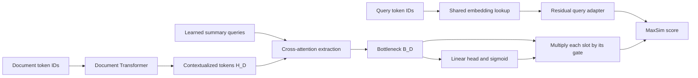

# Latent Bottleneck Compression: Theory and Implementation

This repository trains a reranker that represents a document with a bounded set
of learned vectors. A short query is encoded separately, and relevance is
computed by matching each query vector to its best document vector. The main
idea is to retain the fine-grained matching of a multi-vector model while
limiting how many document vectors must be stored and scored.

This document explains the current Python implementation. Architectural motivations
are distinguished from properties that the losses actually enforce. The
repository does not include measured ranking or edge-latency results.

- [Part 1: Theory](#part-1-theory)
- [Part 2: Implementation](#part-2-implementation)

## Part 1: Theory

### 1.1 The problem: preserve evidence within a fixed vector budget

A reranker assigns a relevance score to a query and each candidate document.
Sorting these scores produces the final candidate ordering. The challenge is
to represent enough evidence to distinguish similar documents without running
an expensive joint query-document model for every candidate.

Three representation choices explain the motivation:

| Approach | Representation and interaction | Main tradeoff |
|---|---|---|
| Cross-encoder | Process the query and document together, allowing their tokens to interact throughout the model. | Rich interactions require a new joint forward pass for each pair. |
| Single-vector encoder | Encode a query and a document into one vector each. | Cheap comparison, but many facts must fit into one document vector. |
| Token-level late interaction | Encode independently, retain a document vector for each token, then match query vectors to document vectors. | Fine-grained matching, but storage and scoring grow with document length. |

This project takes the third approach and changes its document representation.
Instead of retaining every contextualized document token, it learns a fixed
number of summary vectors, called **bottleneck slots**. Each slot can gather
information from the whole encoded document window rather than from one
predefined paragraph.

For example, consider a document that says:

> The Aurora instrument launched in 2019. Its successor, Borealis, launched
> three years later and uses a 14 nm sensor.

A direct query might ask for Borealis's sensor process. An indirect query might
ask which instrument followed Aurora and when it launched. Useful compression
must support the relationship across sentences while preserving the specific
values `2019`, `three years`, and `14 nm`. Training only on a few generated
questions could overlook a value that no question happens to mention.

The model therefore combines relevance supervision with a geometric objective
that encourages coverage of the original token representations. This is lossy
representation learning: it does not reconstruct the document text, quantize
model weights, or produce a textual summary.

### 1.2 Notation and the complete model

| Symbol | Meaning | Default in `configs/default.yaml` |
|---|---|---|
| $Q$ | Query text | — |
| $D$ | Document text | — |
| $L_Q$ | Fixed number of query slots | 32 |
| $L_D$ | Number of real document tokens retained after truncation | At most 768 |
| $d$ | Vector width | 1024 |
| $M$ | Number of bottleneck slots | 256 |
| $H_D$ | Contextualized document tokens | $L_D \times d$ before batching padding |
| $B_D$ | Bottleneck vectors before gating | $M \times d$ |
| $\pi_D$ | Continuous gate values | $M$ |
| $\widetilde B_D$ | Bottleneck after multiplicative gating | $M \times d$ |
| $Q_{\mathrm{latent}}$ | Encoded query vectors | $L_Q \times d$ |
| $S(Q,D)$ | Student relevance score | One scalar |
| $T(Q,D)$ | Discriminative teacher's relevance score | A yes/no probability |

The student has two paths that meet only at scoring:



The document representation is **query independent**. A particular query does
not influence which document vectors the compressor produces. This allows
document compression to be moved offline in a serving system, although this
repository does not yet implement a persistent compressed-document index.

### 1.3 Query encoding: a shallow residual adapter

The query path reuses the document backbone's input embedding table, but does
not run the query through the full document Transformer. It first truncates or
pads the query to $L_Q=32$ token IDs:

$$
X_Q = \operatorname{Embedding}
\left(\operatorname{PadWithMask}(Q,L_Q)\right).
$$

A small, bidirectional Transformer encoder $F_Q$ refines these embeddings:

$$
Q_{\mathrm{latent}}
= \operatorname{LayerNorm}\left(X_Q + F_Q(X_Q)\right).
$$

The residual path supplies the original embedding directly to the final
normalization. Its purpose is to make lexical information accessible while
learning a representation that matches the compressed document space. It is
an architectural bias toward preserving lexical signal, not a mathematical
guarantee of exact token matching: the embeddings, adapter, and normalization
are all trainable.

The implementation uses two Transformer encoder layers, eight attention heads,
and feed-forward width $4d$. Two details affect the theory of this query path:

- **Mask padding participates in computation.** The existing special token
  `<|vision_pad|>` fills unused query slots. These slots are passed through
  self-attention and included in the final MaxSim sum. They are not ignored
  padding; they can learn additional query-dependent matching behavior.
- **The adapter adds no positional encoding.** It receives embedding vectors
  without position embeddings or rotary position information. Its
  self-attention is permutation equivariant, and the final sum over query
  slots makes the score insensitive to permutations of the same query token
  IDs. It can model token co-occurrence, but has no explicit representation of
  query word order. The full document backbone still has its own positional
  machinery.

### 1.4 Document compression in three stages

#### Stage A: contextualize the document

The document backbone produces one contextualized vector for each input token:

$$
H_D = E_D(D) = [h_1,\ldots,h_{L_D}].
$$

The default student backbone is `Qwen/Qwen3-0.6B`. The implementation attempts
to turn its causal attention into bidirectional attention by replacing its
causal-mask construction with a padding-only mask. The intended result is that
each real token can incorporate evidence both before and after its position.
This is useful for references such as “its successor” in the example above.

The document backbone is fully trainable. The system does not freeze it as a
fixed feature extractor. “Whole-document context” here means the retained
token window: with the checked-in YAML configuration, text beyond 768 tokens
is truncated before the student sees it.

#### Stage B: extract a fixed set of summary vectors

The compressor owns a learned matrix of summary queries:

$$
S_0 = [s_1,\ldots,s_M] \in \mathbb R^{M\times d}.
$$

These are model parameters shared across documents. They are not text tokens
and do not occupy positions in the document input. Cross-attention converts
them into document-specific vectors.

For a single attention head, the core operation is:

$$
\operatorname{Attention}(Q_s,K_D,V_D)
= \operatorname{softmax}
\left(\frac{Q_s K_D^\top}{\sqrt{d_h}} + A_D\right)V_D,
$$

where $Q_s$ comes from the summary vectors, $K_D$ and $V_D$ come from the
contextualized document, $d_h$ is the head width, and $A_D$ excludes padded
document keys. Multiple heads provide separate learned projections of the
same inputs.

The actual block uses normalization and residual updates:

$$
\begin{aligned}
R &= S + \operatorname{MHCA}
   (\operatorname{LN}_q(S),\operatorname{LN}_{kv}(H_D),
    \operatorname{LN}_{kv}(H_D)),\\
S' &= R + \operatorname{FFN}(\operatorname{LN}_{ffn}(R)).
\end{aligned}
$$

The FFN is `Linear(d, 4d) → GELU → Linear(4d, d)`. After the configured
number of blocks, the final summary matrix is $B_D$.

Every summary slot can attend across the retained document window. A slot
does not correspond to a fixed span, and a summary vector need not correspond
to a single word. The slots may combine related evidence from distant
positions. The code does not impose a distinct fact per slot or an explicit
diversity constraint, so specialization is learned rather than guaranteed.

#### Stage C: predict continuous retention gates

A shared linear head predicts one scalar per slot:

$$
\pi_k = \sigma(w_g^\top b_k+c_g),
\qquad
\widetilde b_k = \pi_k b_k.
$$

The sigmoid makes the operation differentiable. The same slot can receive a
different gate for each document because its vector $b_k$ already depends on
that document.

The proposal calls this **entropy-driven adaptive gating**. In the current
code, this name describes the intended behavior: documents with more useful
information should justify keeping more capacity. There is no explicit
Shannon entropy calculation, stochastic gate sampling, or entropy-estimation
network. The gate learns from relevance, geometric alignment, and sparsity
losses.

Soft gating also does not change the tensor shape. The compressor always
returns $M$ vectors, and the scorer always evaluates them all. Counts such as
“number of slots with $\pi>0.5$” are diagnostics. Turning them into a smaller
stored representation requires a separate hard-pruning implementation.

### 1.5 Late interaction: MaxSim over the bottleneck

The student score is:

$$
S(Q,D)
= \sum_{i=1}^{L_Q}
  \max_{1\leq k\leq M}
  \frac{q_i^\top\widetilde b_k}{\sqrt d}.
$$

The computation has three steps:

1. Compute all query-slot/document-slot dot products.
2. For each query slot, select its largest document-slot similarity.
3. Sum those best similarities over all query slots.

Different query slots can find evidence in different summary slots. Multiple
query slots may also select the same summary slot; matching is not one-to-one.
The operation is asymmetric because every query slot contributes once, while
document slots contribute only when selected by a maximum.

For a simplified two-query-slot, three-document-slot similarity matrix after
scaling and gating:

| Query slot | Document slot 1 | Document slot 2 | Document slot 3 | Selected value |
|---|---:|---:|---:|---:|
| $q_1$ | 0.8 | 0.1 | 0.3 | 0.8 |
| $q_2$ | 0.2 | 0.9 | 0.4 | 0.9 |

The document score is $0.8+0.9=1.7$. This illustrates how separate pieces of
query evidence can be matched without collapsing the document into one vector.

The score uses **raw dot products**, not cosine similarities. Vector norms and
gate magnitudes therefore matter. The factor $1/\sqrt d$ controls the numerical
scale, but does not bound or calibrate student scores as probabilities.

Gating happens before the maximum. Multiplying by a small gate reduces a
positive similarity, but moves a negative similarity toward zero. Consequently,
a nearly closed slot can still win if other slot similarities are negative.
Deleting such a slot is not exactly equivalent to keeping its softly scaled
vector. Any future hard-pruning policy needs ranking validation.

Despite the proposal's focus on listwise reranking, this scoring function
returns one independent score per query-document pair. The implemented
training objective is margin regression plus auxiliary losses; it does not
contain a listwise softmax, a candidate-list attention mechanism, or a direct
optimization of a ranking metric.

### 1.6 Two teachers provide different kinds of supervision

The design separates generating useful questions from judging relevance.

**The generative teacher supplies training examples.** Upstream generation
produces keypoints, direct queries, indirect queries, negative queries, and
hard negative queries. A keypoint is a factual anchor that associates the
queries with the same document content. The current repository consumes these
JSONL files; it does not contain the generative teacher or its generation loop.
The 70B-class generative model mentioned in the proposal is a design choice,
not a model instantiated here.

**The discriminative teacher supplies numeric targets.** The implemented
teacher is `Qwen/Qwen3-Reranker-8B`. The wrapper puts the instruction, query,
and document into a single prompt, runs one causal-LM forward pass, and reads
the final-position logits for `yes` and `no`:

$$
T(Q,D)
= \frac{\exp(z_{yes})}{\exp(z_{no})+\exp(z_{yes})}
= \sigma(z_{yes}-z_{no}).
$$

This is a two-token relevance probability. The wrapper does not generate an
answer or use the raw logit difference as its stored score. Calling it a
probability describes the calculation; the repository does not evaluate its
statistical calibration.

Teacher scores are precomputed and saved. During student training, the 8B
teacher is not loaded and does not receive gradients.

### 1.7 The four training losses

The losses train complementary behavior: imitate relevance margins, retain
token-level information, align related query formulations, and discourage
unnecessary gate mass.

#### A. Margin-MSE: match relative relevance

The proposal describes comparing a positive and negative document for a fixed
query. The available dataset instead contains a fixed document with positive
and negative **queries**. The implemented margin therefore is:

$$
\begin{aligned}
\Delta s_{pn}
  &= S(Q_p^+,D)-S(Q_n^-,D),\\
\Delta t_{pn}
  &= T(Q_p^+,D)-T(Q_n^-,D),\\
\mathcal L_{margin}
  &= \frac{\sum_{r,p,n} a_{rpn}
       (\Delta s_{rpn}-\Delta t_{rpn})^2}
      {\max(1,\sum_{r,p,n}a_{rpn})}.
\end{aligned}
$$

Here $r$ indexes training rows, $p$ indexes the two positive queries
(direct and indirect), $n$ indexes the combined negative and hard negative
queries, and $a$ masks nonexistent query slots.

For example, teacher scores of 0.9 for a positive query and 0.2 for a negative
query yield a target margin of 0.7. Student scores of 2.0 and 1.3 satisfy the
target just as well as 0.8 and 0.1. The objective fits the difference, not the
two absolute scores. Teacher margins lie in $[-1,1]$ because they are
differences of probabilities.

Every valid positive-negative combination contributes. With two positives,
two ordinary negatives, and two hard negatives, one row contributes eight
margin pairs. Hard negatives are included through the same formula and have
no separate coefficient.

This adaptation matters for interpreting the result. It directly teaches
which queries match a document better. It does not directly compare different
documents for one query. Adding the same offset to every score against one
document leaves these margin targets unchanged, so these targets alone do
not determine cross-document score offsets.

#### B. IDF-weighted Chamfer: preserve coverage and grounding

Relevance supervision observes only the questions present in the training
data. The Chamfer objective adds a geometric comparison between the full
document token set $H_D$ and the summary set $B_D$.

Define a cosine distance:

$$
c_{jk}=1-\frac{h_j^\top b_k}{\lVert h_j\rVert\lVert b_k\rVert}.
$$

The code computes normalized vectors in float32, with a small norm epsilon
for numerical stability. Document padding is excluded from the objective.

**Coverage asks whether every real document token has a nearby summary.**

$$
\mathcal L_{coverage}(D)
= \frac{1}{L_D}
  \sum_{j=1}^{L_D}\operatorname{IDF}(t_j)\min_k c_{jk}.
$$

A rare token receives a larger weight, so losing the direction of a rare
name or technical identifier is intended to cost more than losing a common
token. Each token position contributes separately, including repeated token
IDs. The denominator is the number of real tokens, not the sum of IDF weights.

The repository computes subword-token IDF as:

$$
\operatorname{IDF}(t)
= \log\frac{N_{corpus}}{1+\operatorname{df}(t)},
$$

where document frequency counts documents containing a token at least once.
Unseen token IDs receive $\log(\max(N_{corpus},1))$. The formula is used as
written, without clipping: a token appearing in every document has a small
negative IDF, $\log(N_{corpus}/(N_{corpus}+1))$. Thus coverage is not strictly
a nonnegative divergence under every possible corpus statistic.

**Precision asks whether each important summary is grounded in a real token.**

$$
\mathcal L_{precision}(D)
= \frac{\sum_{k=1}^{M}\pi_k\min_j c_{jk}}
        {\max(\epsilon,\sum_{k=1}^{M}\pi_k)}.
$$

A high-gate summary that is far from every real document token is penalized.
This discourages spending summary capacity on directions unrelated to the
document. Coverage and precision use opposite nearest-neighbor directions;
there is no one-to-one assignment between tokens and slots.

The complete geometric loss averages over the unique documents in a batch:

$$
\mathcal L_{Chamfer}
= \operatorname{mean}_D
  \left[\mathcal L_{coverage}(D)
        +\beta\mathcal L_{precision}(D)\right].
$$

Three qualifications are important for understanding this objective:

1. **Cosine alignment does not enforce magnitude alignment.** MaxSim uses
   raw dot products, so two representations with similar cosine directions
   can still produce different relevance scores because their norms differ.
2. **Both sides are trainable.** The loss does not detach $H_D$. The backbone
   and compressor can both move during optimization; $H_D$ is not a frozen
   lexical reconstruction target. Low geometric loss alone does not prove
   exact fact preservation.
3. **Coverage does not directly require an open gate.** For a positive scalar
   $\pi_k$, $\cos(h_j,\pi_k b_k)=\cos(h_j,b_k)$ when norms are nonzero and
   above the normalization epsilon. The implementation therefore compares
   pre-gate $B_D$ to $H_D$, avoiding near-zero gated norms. Coverage has no
   direct gate factor. Gates enter the precision term as its explicit
   normalized weights, and enter relevance scoring through
   $\widetilde B_D$.

In particular, a uniformly smaller gate vector leaves the normalized
precision ratio approximately unchanged while the denominator remains above
epsilon. The geometric loss by itself is not a guarantee that every
token-covering slot will survive a future hard-pruning threshold.

#### C. Consistency: align direct and indirect query scores

For two queries attached to the same document and keypoint:

$$
\mathcal L_{consistency}
= \operatorname{mean}_r
  \left(S(Q_{direct,r},D_r)-S(Q_{indirect,r},D_r)\right)^2.
$$

This encourages similar relevance for two ways of asking about the same
factual anchor. It compares **scalar scores**, not query embeddings or
attention maps. It therefore does not require the two queries to use the
same bottleneck slots.

Teacher scores for direct and indirect queries may differ. The consistency
term can then compete with margin fitting; its coefficient controls how
strongly equal scoring is preferred.

#### D. Sparsity: penalize total gate mass

The implemented sparsity term is:

$$
\mathcal L_{sparsity}
= \operatorname{mean}_D\sum_{k=1}^{M}\pi_k.
$$

Since gates are nonnegative, this is an $L_1$ penalty on the gate values. It
encourages lower gate mass when other objectives do not justify a larger
value. The sum can be interpreted as an effective soft capacity. It would
equal the expected active count under hypothetical independent Bernoulli
retention, but the implementation does not actually sample such gates.

This penalty is not binary entropy and does not impose a fixed number of
active slots. The hoped-for relationship between information density and
gate counts is an empirical property to inspect after training. Also,
because scoring uses unnormalized vectors, changing vector norms can partly
compensate for gate scaling; gate mass is not a direct measure of stored
information or realized computation.

### 1.8 Joint optimization and the role of each term

The total objective is:

$$
\mathcal L_{total}
= \mathcal L_{margin}
 +\lambda_{Chamfer}\mathcal L_{Chamfer}
 +\lambda_{consistency}\mathcal L_{consistency}
 +\lambda_{sparsity}\mathcal L_{sparsity}.
$$

The checked-in configuration sets:

| Parameter | Value | Effect |
|---|---:|---|
| $\lambda_{Chamfer}$ | 1.0 | Strength of geometric coverage and grounding |
| $\lambda_{consistency}$ | 0.5 | Strength of direct/indirect score agreement |
| $\lambda_{sparsity}$ | 0.01 | Cost of total gate mass |
| $\beta$ | 1.0 | Precision weight within Chamfer |

The scales of the losses differ. Sparsity is a sum over 256 slots per
document, whereas margin-MSE averages over valid query pairs. Coefficients
should therefore be interpreted together with the logged component values.

The shared embedding table, document backbone, query adapter, summary queries,
cross-attention blocks, and gating head are optimized jointly. Chamfer and
sparsity are averaged over unique documents; margin and consistency are based
on keypoint rows. If several rows share a document, they add query supervision
without repeating that document's geometric penalty within the same batch.

### 1.9 What compression saves, and what remains expensive

Let a conventional multi-vector representation retain $L_D$ document vectors.
Its representation storage is proportional to $L_Dd$. This bottleneck instead
stores $Md$ vector elements, independent of document length once encoded.

For a 768-token document and the default $M=256$, the vector-count reduction
is $768/256=3$. For a document shorter than 256 tokens, a dense 256-slot
representation can actually contain more vectors than the token-level
representation. The current model provides a fixed upper budget, not a
guaranteed reduction for every input.

At $M=256$ and $d=1024$, the vector payload alone would occupy:

- 524,288 bytes, or 0.5 MiB, if stored with two-byte elements;
- 1,048,576 bytes, or 1 MiB, if stored with four-byte elements.

These figures exclude model weights, IDs, gate metadata, indexing overhead,
and temporary tensors. They describe possible representation storage; no
compressed-index storage format is implemented, and bf16 training does not
automatically define an inference storage dtype.

MaxSim performs $L_QM=32\times256=8,192$ vector dot products per document,
each of width 1024. Its arithmetic cost is $O(L_QMd)$, approximately 8.39
million scalar multiply-accumulates for the dot products at these defaults.
“8,192 interactions” does not mean 8,192 scalar operations.

Document encoding remains the expensive part: the full Transformer runs
before compression, and the cross-attention interaction itself costs
$O(ML_Dd)$ in addition to projections and feed-forward layers. The backbone
also retains its self-attention and feed-forward costs. Training must keep
uncompressed hidden states and compute the $L_D\times M$ Chamfer matrix.

The intended serving advantage comes from compressing documents in advance
and encoding a query once for many candidates. The current repository exposes
the necessary encoders and scorer, but does not implement that serving
pipeline, hard pruning, quantization, NPU export, or latency benchmarks. A
bounded interaction size alone does not establish sub-millisecond latency.

## Part 2: Implementation

### 2.1 Repository structure and responsibilities

```text
reranking/
├── README.md
├── configs/
│   └── default.yaml
├── docs/
│   ├── proposal.tex
│   └── compression.md
├── scripts/
│   ├── run_build_index.sh
│   ├── run_build_idf.sh
│   ├── run_precompute_teacher.sh
│   └── run_train.sh
└── src/
    ├── __init__.py
    ├── config.py
    ├── losses.py
    ├── train.py
    ├── data/
    │   ├── __init__.py
    │   ├── build_index.py
    │   ├── idf.py
    │   └── dataset.py
    ├── distill/
    │   ├── __init__.py
    │   ├── teacher_qwen_reranker.py
    │   └── precompute_teacher_scores.py
    ├── model/
    │   ├── __init__.py
    │   ├── bidirectional.py
    │   ├── document_compressor.py
    │   ├── query_adapter.py
    │   └── reranker.py
    └── eval/
        ├── __init__.py
        ├── inspect_bottleneck.py
        └── sample_beir_compress.py
```

The tree shows source and documentation, omitting Python cache files. Runtime
directories such as `data/` and `runs/default/` are created by pipeline stages
and are not present in the inspected working tree.

| Theory component | Implementation entry point |
|---|---|
| Configuration and YAML overrides | [`Config.from_yaml`](../src/config.py) |
| Join upstream supervision into training rows | [`build_unified_examples`](../src/data/build_index.py) |
| Corpus token IDF | [`build_idf_table`](../src/data/idf.py) |
| Teacher probabilities | [`QwenRerankerTeacher.score_batch`](../src/distill/teacher_qwen_reranker.py) |
| Save teacher-scored examples | [`_score_chunk` and `main`](../src/distill/precompute_teacher_scores.py) |
| Lazy training data and query/document tokenization | [`ScoredExamplesDataset` and `Collator`](../src/data/dataset.py) |
| Padding-only document attention | [`make_bidirectional`](../src/model/bidirectional.py) |
| Query adapter | [`ResidualQueryAdapter`](../src/model/query_adapter.py) |
| Summary extraction and gates | [`DocumentCompressor` and `CrossAttnBlock`](../src/model/document_compressor.py) |
| Shared model and MaxSim | [`LatentBottleneckReranker`](../src/model/reranker.py) |
| Four losses and weighted combination | [`src/losses.py`](../src/losses.py) |
| Batch forward pass and optimization | [`forward_batch_and_loss` and `main`](../src/train.py) |
| Gate and representation inspection | [`src/eval/inspect_bottleneck.py`](../src/eval/inspect_bottleneck.py) |
| Out-of-domain compressor diagnostics | [`src/eval/sample_beir_compress.py`](../src/eval/sample_beir_compress.py) |

### 2.2 Configuration: what controls each stage

[`src/config.py`](../src/config.py) defines five dataclasses: `ModelConfig`,
`TeacherConfig`, `DataConfig`, `LossConfig`, and `TrainConfig`, collected in
`Config`. `Config.from_yaml(path)` starts from the Python defaults and
replaces fields present in each YAML section. Passing no path uses only the
dataclass defaults.

The checked-in [default YAML](../configs/default.yaml) specifies:

| Section | Important settings |
|---|---|
| `model` | Backbone `Qwen/Qwen3-0.6B`; width 1024; 256 summary slots; query length 32; two query layers; one cross-attention layer; eight heads for both adapters; document length 768; mask token `<\|vision_pad\|>` |
| `teacher` | `Qwen/Qwen3-Reranker-8B`; maximum length 1024; bf16; batch size 16 |
| `data` | Upstream source directories; unified JSONL, scored JSONL, and IDF paths; two negatives and two hard negatives per keypoint |
| `loss` | Chamfer 1.0; consistency 0.5; sparsity 0.01; Chamfer precision factor 1.0 |
| `train` | AdamW learning rate `2e-5`; weight decay 0.01; batch size 8; accumulation 4; five epochs; warmup ratio 0.05; bf16 enabled |
| `train` continued | Output `runs/default`; console logging every 20 optimizer steps; checkpoint every 1000; seed 42; two data workers; gradient norm limit 1.0 |

The distinction between YAML values and actual CLI configuration matters:

- `src.train` reads the YAML. Its CLI can override `--scored-path`,
  `--idf-path`, and `--output-dir`.
- The data-building, IDF, and teacher-precomputation CLIs use their own
  arguments. They do **not** load the YAML. The shell wrappers pass explicit
  arguments to those CLIs.
- In particular, `run_precompute_teacher.sh` uses a score batch size of 32
  and leaves maximum length at the precomputation CLI default of 4096. The
  YAML's teacher batch size 16 and maximum length 1024 do not change that
  invocation. Set `--score-batch-size` and `--max-length` explicitly to
  change it.
- Negative-list limits are applied during teacher precomputation. Training
  consumes the lists already stored in the scored file; it does not trim
  them again according to `cfg.data.neg_per_keypoint` or
  `cfg.data.hardneg_per_keypoint`.
- Without `--config`, Python defaults differ in several places: student
  document length is 512, teacher length is 4096, and training is three
  epochs. The training wrapper explicitly selects `configs/default.yaml`.

The configured width must match the loaded backbone's output width, and the
head counts must be compatible with that width. Changing only the model name
does not automatically derive a new `hidden_size` or make the attention-mask
patch compatible with a different architecture.

### 2.3 Build the training examples

[`src/data/build_index.py`](../src/data/build_index.py) reads three source
patterns from two directories:

| Pattern | Fields used by this repository |
|---|---|
| `full_run/keypoints_part*.jsonl` | `doc_id`, `body` |
| `full_run/keypoint_queries_part*.jsonl` | `doc_id`, keypoint text, queries labeled `direct` or `indirect` |
| `negative_query/negative_queries_part*.jsonl` | `doc_id`, keypoint text, `negative_queries`, `hard_negative_queries` |

The files are not assumed to be line-aligned. `_load_jsonl_by_doc_id` loads
each source group into a dictionary keyed by `doc_id`; a repeated ID replaces
the earlier record. The builder takes the intersection of IDs present in all
three source groups, then joins the positive and negative entries within a
document by the **exact keypoint string**.

A row is emitted only if it has a nonempty canonical body, both a direct and
an indirect query, a matching negative-source keypoint, and at least one
negative query of either kind. Missing keypoint matches are counted. There is
no fuzzy keypoint matching or semantic alignment step.

The resulting unit is one `(doc_id, keypoint)` row, for example:

```json
{
  "doc_id": "example-001",
  "keypoint": "Borealis uses a 14 nm sensor.",
  "body": "The Aurora instrument launched in 2019. Its successor, Borealis, launched three years later and uses a 14 nm sensor.",
  "direct_query": "What sensor process does Borealis use?",
  "indirect_query": "What sensor process does Aurora's successor use?",
  "negative_queries": ["How deep is the Pacific Ocean?"],
  "hard_negative_queries": ["Does Borealis use a 7 nm sensor?"]
}
```

This is an illustrative schema, not an excerpt from the corpus. Negative
queries are supplied upstream; the joiner does not validate their meaning.
Several keypoint rows can repeat the same document body. `keypoint` determines
which queries belong together, but is not separately fed to the student or
teacher. Student training uses `body` as document text, without adding title
or URL fields.

Output rows are streamed to `data/unified_examples.jsonl`, but the three
source dictionaries are loaded into memory before the join. Thus the join is
not fully streaming with respect to raw corpus memory. Its `--limit` caps
records read across each source group, rather than guaranteeing that many
joined documents or output rows.

### 2.4 Build token-level IDF statistics

[`src/data/idf.py`](../src/data/idf.py) scans nonempty bodies from
`keypoints_part*.jsonl`, independently of which documents survive the training
join. It uses the student tokenizer, takes up to 4096 tokens per body, and
converts each tokenized document into a set. A token occurring ten times in
one document therefore increments its document frequency only once.

Processing can run sequentially or through `ProcessPoolExecutor`. Each worker
initializes its own tokenizer. The final table has `len(tokenizer)` entries
and stores the IDF formula described in Part 1.

The saved `data/idf_table.pt` object is a dictionary:

```python
{
    "idf": idf_tensor,       # float32, shape (vocabulary_size,)
    "n_docs": document_count,
    "tokenizer": tokenizer_name,
}
```

Training loads `idf_blob["idf"]` and indexes it directly with student token
IDs. The table must therefore correspond to the student's tokenizer. The
current training loader does not verify the stored tokenizer metadata. Note
also that IDF statistics use a 4096-token prefix, while the YAML-configured
student training window is 768 tokens.

### 2.5 Precompute discriminative teacher scores

[`teacher_qwen_reranker.py`](../src/distill/teacher_qwen_reranker.py) loads
the teacher through `AutoModelForCausalLM`, moves it to the requested device,
and sets evaluation mode. The teacher retains causal attention; the student's
bidirectional patch is not applied to it.

The wrapper formats each pair as:

```text
<Instruct>: Given a web search query, retrieve relevant passages that answer the query
<Query>: {query}
<Document>: {document}
```

This text is placed between a system/user prefix requesting a `yes`/`no`
judgment and an assistant suffix containing an empty thinking block.
`_process_inputs` reserves space for that prefix and suffix before truncating
the pair text. Left padding makes the last position the end of each real
prompt. `score_batch` requests the final-position logits with
`logits_to_keep=1`, selects the two label logits, and returns their two-class
softmax probability for `yes`. Scoring runs under `torch.no_grad()`.

[`precompute_teacher_scores.py`](../src/distill/precompute_teacher_scores.py)
then performs the following work:

1. Read unified rows in chunks, with a default chunk size of 256 records.
2. Keep the first two negative and first two hard negative queries by
   default. This is deterministic prefix selection, not random sampling.
3. Flatten all direct, indirect, negative, and hard negative pairs in the
   chunk into one list. Each pair uses the row's same document body.
4. Score that list in batches, defaulting to 32 pairs per batch.
5. Restore each score to its source row and append complete JSON lines to
   `data/unified_examples.scored.jsonl`.

The scored row retains the query text and adds:

```json
{
  "teacher_scores": {
    "direct": 0.94,
    "indirect": 0.89,
    "negative_queries": [0.02],
    "hard_negative_queries": [0.18]
  }
}
```

These numbers are illustrative. Score arrays must have the same lengths and
ordering as their corresponding query arrays.

Resume is based on the existing output line count: the script skips that
many input lines and appends more output. It assumes that the source order,
teacher settings, and negative limits have not changed and that existing
lines are complete. It does not compare IDs, record a configuration manifest,
or repair a partially written final line. `--overwrite` starts the scored
output again. The current `--limit` accounting advances when a chunk is
written, so it is not a strict per-record cap within a pending chunk.

Teacher prompts use the original query and body under the teacher's token
budget. They are not first truncated to the student's 32-token query and
768-token document windows. Consequently, some teacher judgments can depend
on information unavailable to the student.

### 2.6 Load data and construct tensor batches

[`ScoredExamplesDataset`](../src/data/dataset.py) scans the scored JSONL once
and records byte offsets for nonempty lines. It loads a row on demand with
`seek` and `json.loads`, opening its file handle lazily. The offset list stays
in memory, but full document bodies and query strings do not all remain
resident.

`Collator` turns a list of rows into tensors. Let:

- $B$ be the number of keypoint rows in the batch;
- $U\leq B$ be the number of distinct `doc_id` values;
- $L$ be the configured padded document length;
- $N$ and $N_h$ be the batch's padded ordinary- and hard-negative counts.

The collator deduplicates document bodies by `doc_id`, keeping the first body
for each ID, and builds a `doc_index` mapping from rows to unique documents.
For example:

```text
Row document IDs:  [A, B, A]
Unique documents: [A, B]
doc_index:        [0, 1, 0]
```

Both document encoding and document-only losses operate on the two unique
documents in this example. Query scores gather the appropriate bottleneck
back for each of the three rows.

| Batch field | Shape | Meaning |
|---|---|---|
| `doc_input_ids` | `(U, L)` | Truncated bodies, padded to `doc_max_len` |
| `doc_attention_mask` | `(U, L)` | One for real document tokens, zero for padding |
| `doc_index` | `(B,)` | Unique-document index for each keypoint row |
| `direct_query_ids`, `indirect_query_ids` | `(B, L_Q)` each | Positive query token IDs |
| `neg_query_ids` | `(B, N, L_Q)` | Ordinary negative queries |
| `hardneg_query_ids` | `(B, N_h, L_Q)` | Hard negative queries |
| `neg_query_mask`, `hardneg_query_mask` | `(B, N)`, `(B, N_h)` | Real query entries versus absent batch slots |
| `teacher_direct`, `teacher_indirect` | `(B,)` each | Positive teacher scores |
| `teacher_neg`, `teacher_hardneg` | `(B, N)`, `(B, N_h)` | Padded teacher-score arrays |

Documents use the tokenizer's document padding behavior and an attention
mask. Queries use `pad_query_ids`: no added special tokens, truncation to
`query_max_len`, then right filling with the configured mask token. The
collator validates that this token exists in the vocabulary.

There are two distinct meanings of padding here. Query **token** fill slots
participate in encoding and scoring. Missing negative **query entries** are
excluded from margin-MSE by the negative-query masks. Each negative tensor
has at least one slot even when no query of that kind exists in a batch, so
the training code can keep a uniform tensor path. Such dummy queries are
encoded but contribute no valid margin pairs.

### 2.7 Construct the model and its tensor interface

[`LatentBottleneckReranker.__init__`](../src/model/reranker.py) loads one
`AutoModel` backbone, applies `make_bidirectional`, and passes references to
its components into the two towers:

- `ResidualQueryAdapter` receives `backbone.get_input_embeddings()`.
- `DocumentCompressor` receives the full backbone.

These are shared parameter references, not independently copied models. The
query path updates the same embedding table that the document path uses. No
parameters are explicitly frozen. Newly added adapter, attention, and gate
layers use normal PyTorch initialization; summary queries are initialized as
Gaussian values scaled by 0.02.

The backbone is loaded without forcing bf16 weights. The implementation keeps
the master parameters in float32 and relies on Accelerate's mixed-precision
execution during training. This also keeps the pretrained backbone compatible
with freshly initialized float32 layers.

[`make_bidirectional`](../src/model/bidirectional.py) replaces the backbone
instance's `_update_causal_mask` method with a bound Python method. For a
document attention mask, it builds an additive mask of shape `(U, 1, L, L)`:
zero at attendable key positions and the dtype's minimum finite value at
padded key positions. It removes the triangular restriction rather than
changing the Transformer layer weights.

This is a dependency on a private Transformers method. The function raises
`TypeError` if the loaded backbone does not expose that method. Successful
bidirectional behavior depends on a compatible model implementation and
attention backend; the repository provides no dependency lockfile or
compatibility test for that patch.

`DocumentCompressor.forward(input_ids, attention_mask)` returns:

| Key | Shape | Consumer |
|---|---|---|
| `h_d` | `(U, L, d)` | Chamfer loss; norm diagnostics |
| `doc_attention_mask` | `(U, L)` | Document token validity metadata |
| `b_d` | `(U, M, d)` | Chamfer loss; representation inspection |
| `pi` | `(U, M)` | Precision weighting; sparsity; gate diagnostics |
| `b_d_tilde` | `(U, M, d)` | Relevance scoring |

The cross-attention block converts the document mask to a PyTorch
`key_padding_mask`, where `True` means “ignore this key.” Its attention uses
`batch_first=True`, eight heads by default, zero dropout, and does not return
attention weights. It contains cross-attention and an FFN; there is no
separate summary-slot self-attention layer.

`encode_query(input_ids)` returns `(batch, L_Q, d)`.
`maxsim(q, b)` accepts broadcastable leading batch dimensions, builds the
similarity matrix with `torch.einsum("...qd,...kd->...qk", q, b)`, multiplies
by `1 / sqrt(hidden_size)`, takes the maximum over document slots, and sums
over query slots.

The model's `forward(mode=..., **kwargs)` dispatches to `encode_query` or
`encode_document`. During training, these parameterized paths are called
through the Accelerate-wrapped model's `__call__`, so a distributed wrapper
can instrument the forward calls. `maxsim` has no trainable parameters of its
own and is called on `accelerator.unwrap_model(model)`. This explains the
mode dispatch; it is not an end-to-end `forward(query, document)` API.

### 2.8 Execute one training batch

[`forward_batch_and_loss`](../src/train.py) ties the representation paths
to the four losses:

```text
1. Encode U unique documents.
2. Gather b_d_tilde[doc_index] to obtain B row-specific bottlenecks.
3. Encode direct and indirect queries, then score each against its document.
4. Flatten ordinary negatives from (B, N, L_Q) to (B*N, L_Q), encode,
   restore their batch dimensions, and score against the same documents.
5. Repeat for hard negatives.
6. Stack the two positive score columns; concatenate both negative kinds.
7. Compute margin-MSE over all valid positive-negative combinations.
8. Compute Chamfer on U unique documents using h_d, b_d, pi, token IDs,
   the document mask, and the IDF table.
9. Compute direct/indirect score consistency over B rows.
10. Compute summed gate mass averaged over U unique documents.
11. Weight and add the four components.
```

[`src/losses.py`](../src/losses.py) implements these calculations directly.
Margin masks are multiplied into the squared errors, with a denominator
clamped to at least one. Chamfer casts representations to float32 before
normalizing, masks padded document positions out of nearest-token precision,
and clamps its gate-sum denominator. `total_loss` returns the differentiable
scalar together with Python numeric values for component logging.

There is no cross-document comparison in this batch path. A negative query
for document A is scored against A, not against every document in the batch.
Document deduplication is a compute optimization, not in-batch negative
sampling.

The main training loop then:

1. Seeds Python, NumPy, and PyTorch; initializes `Accelerator` with configured
   gradient accumulation and optional bf16 mixed precision.
2. Creates the tokenizer, model, IDF table, lazy dataset, and shuffled
   DataLoader. `drop_last=True` drops incomplete batches.
3. Prepares the DataLoader before computing schedule length, so its length
   reflects distributed sharding. The schedule estimate is
   `(len(prepared_loader) // grad_accum_steps) * epochs`.
4. Creates AdamW and a linear warmup/decay scheduler, then prepares the model,
   optimizer, and scheduler with Accelerate.
5. Runs forward and backward inside `accelerator.accumulate(model)`, clips
   gradients when they synchronize, and invokes the wrapped optimizer and
   scheduler steps.
6. Advances `global_step` on synchronized optimizer updates and saves/logs
   from the main process.

With batch size 8 and four accumulation steps, a full accumulation window
contains 32 keypoint rows per process. Across $W$ processes, the nominal
effective batch is $32W$ rows, subject to sharding and final partial-window
behavior. The number of unique documents can be smaller.

`total_steps` uses floor division, so it can underestimate updates if the
prepared DataLoader has a final partial accumulation window. The code does
not include a separate validation loop, early stopping, or model selection
based on retrieval metrics.

Training writes the following to the output directory:

| Artifact | Contents |
|---|---|
| `metrics.csv` | Step, epoch, elapsed time, total loss, and all four unweighted loss components |
| TensorBoard tracker output | The logged loss dictionary under tracker name `latent_reranker` |
| `checkpoint-<step>.pt` | Full model `state_dict` at the configured save interval |
| `final_model.pt` | Full model `state_dict` after the loop |

CSV and TensorBoard values are taken from the last microbatch at each
synchronized update on the main process; the code does not explicitly average
them across an accumulation window or all processes. Checkpoints contain
weights, not optimizer, scheduler, random-generator, or data-iteration state.
There is no training-resume CLI, and the configuration/tokenizer are not
packaged into the checkpoint. Reloading requires the corresponding model
configuration and tokenizer to be available.

### 2.9 Run the pipeline and use the learned representation

Run the shell wrappers from a Python environment with the required packages
and access to the source data and pretrained model files:

```bash
# 1. Join canonical bodies, positive queries, and negative queries.
./scripts/run_build_index.sh

# 2. Compute IDF using the student tokenizer.
./scripts/run_build_idf.sh

# 3. Precompute teacher probabilities. This stage loads the 8B teacher.
./scripts/run_precompute_teacher.sh

# 4. Train the student. This stage reads the saved scores, not the teacher.
./scripts/run_train.sh
```

Each wrapper changes to the repository root and forwards extra arguments to
its Python CLI. IDF construction and teacher precomputation are independent
once their respective source inputs are available; training requires both
outputs. Teacher precomputation additionally requires the unified JSONL.

The source imports `torch`, `transformers`, `accelerate`, `numpy`, `PyYAML`,
`tqdm`, and TensorBoard support for the core pipeline. Optional visualization
uses `matplotlib`, and BEIR sampling uses `datasets`. The repository currently
has no `requirements.txt`, `pyproject.toml`, or pinned dependency environment;
in particular, the private attention patch and teacher's `logits_to_keep`
argument require compatible Transformers implementations.

Training can also be launched directly:

```bash
accelerate launch -m src.train \
  --config configs/default.yaml \
  --scored-path data/unified_examples.scored.jsonl \
  --idf-path data/idf_table.pt \
  --output-dir runs/default
```

For a minimal single-pair inference example using the existing API:

```python
import torch
from transformers import AutoTokenizer

from src.config import Config
from src.data.dataset import pad_query_ids
from src.model.reranker import LatentBottleneckReranker

cfg = Config.from_yaml("configs/default.yaml")
tokenizer = AutoTokenizer.from_pretrained(cfg.model.backbone_name)
model = LatentBottleneckReranker(cfg.model)
model.load_state_dict(
    torch.load("runs/default/final_model.pt", map_location="cpu")
)
model.eval()

document = "Borealis uses a 14 nm sensor."
query = "What sensor process does Borealis use?"
doc_inputs = tokenizer(
    document,
    add_special_tokens=False,
    truncation=True,
    max_length=cfg.model.doc_max_len,
    return_tensors="pt",
)
mask_id = tokenizer.convert_tokens_to_ids(cfg.model.mask_token)
query_ids = torch.tensor([
    pad_query_ids(tokenizer, query, cfg.model.query_max_len, mask_id)
], dtype=torch.long)

with torch.no_grad():
    doc_out = model.encode_document(
        doc_inputs["input_ids"], doc_inputs["attention_mask"]
    )
    query_vectors = model.encode_query(query_ids)
    score = model.maxsim(query_vectors, doc_out["b_d_tilde"])

print(score.item())
```

This example runs on CPU with the model's ordinary loaded parameter dtype;
it is an API illustration, not a latency benchmark. For many documents, a
serving application could cache each `b_d_tilde`, encode the query once, score
the cached representations, and sort the results. That cache and candidate
management remain application code to be built.

### 2.10 Inspect the compressor and understand the current scope

[`inspect_bottleneck.py`](../src/eval/inspect_bottleneck.py) loads the same
model and optional checkpoint, sets evaluation mode, and encodes either raw
`--text` or a `--doc-id` body found in a unified JSONL file. Omitting a
checkpoint leaves the added compressor/adapter layers randomly initialized;
the backbone still comes from the pretrained model.

Its inspection modes include:

| Mode or option | What it reports |
|---|---|
| Default inspection | Top slots by gate, nearest vocabulary tokens, and nearest token occurrence in the document |
| `--pi-only` | All gates, summary statistics, and counts above several thresholds |
| `--out-heatmap` | PNG of slot/document-token cosine similarities |
| `--out-html` | Document tokens colored by their nearest displayed slot |
| `--compare-norms` | L2-norm statistics for pre-gate summaries and contextualized document tokens |
| `--out-norm-plot` | Optional histogram for the norm comparison |
| `--probe-token` | Similarity of a chosen token embedding to the highest-gated slots, with a bar plot |

For example, to inspect gate behavior without vocabulary comparisons:

```bash
python -m src.eval.inspect_bottleneck \
  --config configs/default.yaml \
  --checkpoint runs/default/final_model.pt \
  --text "Borealis uses a 14 nm sensor." \
  --pi-only
```

The nearest-neighbor displays compare pre-gate `b_d` with **raw input
embeddings** from the shared table, either over the whole vocabulary or over
tokens present in the document. They do not compare contextualized `h_d`
vectors in that display. The source explains this choice as a
way to avoid dominant shared hidden-state dimensions overwhelming the visual
nearest-neighbor comparison.

The helper `_cos` itself is ordinary `torch.nn.functional.cosine_similarity`;
it performs no whitening or per-dimension correction. Raw embedding neighbors
are an interpretability heuristic, not a reconstruction of a slot's exact
meaning or a display of the training attention weights. Scalar norm
differences alone also cannot explain cosine differences, since cosine
normalizes magnitude; the separate norm tool diagnoses scale relevant to
dot-product scoring. If a probe string tokenizes into several pieces, the
probe uses only its first piece.

[`sample_beir_compress.py`](../src/eval/sample_beir_compress.py) loads a
corpus through `datasets.load_dataset("BeIR/<name>", "corpus")`, combines
title and text, samples documents with a seeded shuffle, and compresses them
one at a time. It reports token counts, gate statistics, counts above 0.5 and
0.1, and the vocabulary neighbor of the highest-gated slot. CSV output and
multi-document HTML visualization are optional. Its CLI leaves the model on
CPU and exposes no device option.

These tools inspect representation and gate behavior. They do not load BEIR
queries or relevance judgments, compute nDCG/MRR/recall, compare a reranking
baseline, or measure deployment latency.

The following distinctions define the implementation's current scope:

| Design goal or possible extension | Current behavior |
|---|---|
| Bounded document representation | Implemented: every document produces exactly `num_summary_tokens` vectors before any external pruning. |
| Adaptive physical vector count | Soft gates and threshold diagnostics exist; physical slot removal and a pruned storage format do not. |
| Long-document reasoning | Attention can combine evidence within the retained input window; no chunking or recovery of truncated text is implemented. |
| Two-teacher training | Generative outputs are external inputs; discriminative teacher scoring is implemented. |
| Teacher margin matching | Implemented for varying queries against a fixed document, using probability differences. |
| Lexical retention | Encouraged by residual query features and IDF-weighted geometry; exact fact preservation is not verified or guaranteed. |
| Cross-document negatives | Not implemented, including in-batch document negatives. |
| Listwise ranking objective | Not implemented; independent pair scoring can be used to order a candidate list. |
| Persistent serving index or export | Not implemented; the code provides encoders, soft bottlenecks, and MaxSim. |
| Training continuation | Weight checkpoints exist; full optimizer/scheduler resume does not. |
| Ranking and hardware validation | Inspection utilities exist; automated ranking benchmarks, edge export, and latency measurements are absent. |
