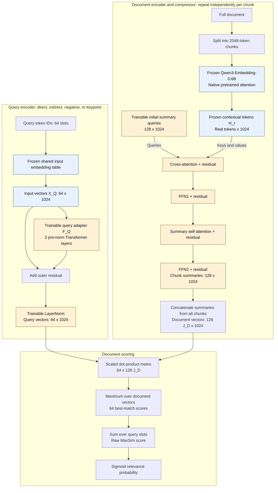

# Latent Bottleneck Compression

This design learns a compact, query-independent representation of a document.
A frozen `Qwen/Qwen3-Embedding-0.6B` encoder supplies contextual token vectors;
a trainable compressor turns them into summary vectors. Queries and keypoints
learn to retrieve the right documents through the same query path.

This file explains the theory. See [implementation.md](implementation.md) for
the code changes and [evaluation.md](evaluation.md) for vector selection and
retrieval metrics. The revised design is not yet implemented in the checked-in
training code.

## 1. Frozen features and trainable summaries

Let $E_0$ be the frozen embedding encoder, including its input embedding
table. Its native hidden-state width is $d=1024$, as specified in the
[official checkpoint configuration](https://huggingface.co/Qwen/Qwen3-Embedding-0.6B/blob/main/config.json).
The number of summary vectors is separate from their width: **128 vectors
does not mean 128-dimensional vectors**.

Split the complete document into nonoverlapping chunks of $C=2048$ tokens.
Only the final chunk is padded; discard no real tokens. Each chunk produces
**$M=128$ summary vectors**, each with 1024 components. A document with $J_D$
chunks therefore has $128J_D$ vectors before post-training selection.

For chunk $C_r$ with $\ell_r$ real tokens, compute:

$$
H_r=\operatorname{stopgrad}(E_0(C_r))
\in\mathbb R^{\ell_r\times1024}.
$$

Keep the encoder in evaluation mode with gradient recording disabled.
Use the checkpoint's native pretrained attention; do not apply the existing
bidirectional attention modification. The same frozen $H_r$ supplies
compressor inputs and the token-coverage reference. A second frozen encoder
is unnecessary when both uses have the same tokenizer, chunk boundaries,
attention behavior, and checkpoint revision.

A shared learned matrix $Z^{(0)}\in\mathbb R^{128\times1024}$ initializes
every chunk's summary slots. The compressor independently refines these
slots against that chunk's $H_r$, producing $S_r$. All chunks share the same
compressor parameters. Concatenate the results to represent a full document:

$$
S_D=\operatorname{Concat}(S_1,\ldots,S_{J_D}).
$$

The compressor architecture is shown below. Its output vectors are learned
continuous representations, not text summaries or selected source tokens.
Document compression never depends on the query, so its output can be cached.

There is **no gating head, multiplicative gate, keypoint matching loss, or
sparsity loss**. Train using every summary slot; select a smaller subset only
after training.

## 2. Query encoding and document scoring

The architecture below shows the training path with all 128 summaries per
chunk. It retains the existing configurable defaults of two query-adapter
layers, one summary-refinement block, and eight heads in each adapter or
compressor attention module, using the revised width and token budgets.

Blue nodes contain frozen parameters or fixed features; orange nodes contain
trainable parameters. The query lookup shares the document encoder's input
embedding table and bypasses its full Transformer. Each query-adapter layer
contains bidirectional self-attention and a feed-forward network, with
pre-normalization and a residual around each operation. The outer residual
shown in the diagram is additional to those internal residuals.

In the compressor, cross-attention reads the frozen chunk tokens using the
current summaries as queries. Summary self-attention exchanges information
between the 128 slots. All four stages use pre-normalization and residual
connections. Both compressor FFNs and the query-adapter FFNs use
`Linear(1024, 4096) -> GELU -> Linear(4096, 1024)`; the two compressor FFNs
have separate weights.

After training, apply the coverage-based selection from Section 5 to each
chunk's final summaries **before concatenation**. The scoring path then uses
the retained document vectors instead of all $128J_D$ vectors.

Formally, the query encoder computes:

$$
X_Q=\operatorname{Embedding}_0(Q),\qquad
Q_{\mathrm{latent}}=\operatorname{LayerNorm}(X_Q+F_Q(X_Q)).
$$

The lookup table remains fixed; the adapter and its normalization learn.
Direct queries, indirect queries, negative queries, and keypoint queries
all use this path. A keypoint is a positive query for its source document,
not a separate target-encoding branch.

Truncate or fill each query to **64 token slots**, including keypoint queries.
The existing special-token fill slots participate in the adapter and scoring.
This limit does not preserve keypoint text beyond the first 64 tokens.

Let $S_D$ contain all summary vectors for document $D$. For query
vectors $q_i$, use the existing late-interaction score:

$$
s(Q,D)=\sum_{i=1}^{L_Q}\max_{s_k\in S_D}
\frac{q_i^\top s_k}{\sqrt d}.
$$

Each query vector selects its best summary anywhere in the document, then
the selected scores are summed. Use the summary vectors directly, without
gates. At evaluation time, replace $S_D$ with the retained subset.

## 3. Positive pairs and both kinds of negatives

For every source document $D^+$, use its direct queries, indirect queries,
and keypoints as positive queries $Q^+$. Include both negative directions:

| Pair | Meaning |
|---|---|
| $(Q^+,D^+)$ | A query or keypoint matched to a relevant document |
| $(Q^+,D^-)$ | The same positive query matched to an irrelevant document |
| $(Q^-,D^+)$ | An irrelevant ordinary or hard-negative query matched to the source document |

Negative documents may come from the batch or a training-corpus candidate
pool. Other documents are not automatically irrelevant: exclude known
relevant documents and duplicate bodies. A negative query is negative only
for its labeled document; do not assume it is negative for every document.
Different keypoint rows of the same document do not create negative documents.

Deduplicate documents before encoding them, while preserving the relevance
labels and valid-pair masks. Keypoints must contribute the same positive and
negative-document supervision as other positive queries.

## 4. Training objective

**Teacher BCE is the only relevance loss.**. For every selected pair, including keypoint queries
and other-document pairs, the frozen `Qwen/Qwen3-Reranker-8B` supplies a
precomputed relevance target:

$$
p_T(Q,D)=\frac{\exp(\ell_{\mathrm{yes}})}
{\exp(\ell_{\mathrm{yes}})+\exp(\ell_{\mathrm{no}})}.
$$

The teacher judges the full candidate document, not individual chunks or a
silently truncated prefix. The query text and teacher settings are recorded
with each target. A different candidate document requires its own teacher
score. Positive/negative pair labels guide sampling; they do not replace
the teacher probability with a hard 1 or 0.

Use the student's raw MaxSim score directly as the relevance logit. The
predicted relevance probability is:

$$
p_S(Q,D)=\sigma(s(Q,D)).
$$

With $\mathcal P$ the valid selected pairs, compute stable soft-target BCE:

$$
\mathcal L_{\mathrm{BCE}}=
\frac{1}{|\mathcal P|}\sum_{(Q,D)\in\mathcal P}
\left[\operatorname{softplus}(s(Q,D))-p_T(Q,D)s(Q,D)\right].
$$

Pass the raw score directly to BCE-with-logits; use sigmoid only to report
relevance probabilities.

Average source-document and other-document pairs together. Missing pairs
or teacher targets are masked out, never interpreted as zero relevance.
If no pair has a valid target, the BCE contribution is zero.
Record the negative sampling budget because it changes the mix of pairs.

**Token coverage remains a training loss.** It encourages the summaries to
retain frozen token features beyond the questions seen during training.
For token $j$ in chunk $r$, use nonnegative full-document IDF weights:

$$
w_{r,j}=\log\frac{N+1}{\operatorname{df}(t_{r,j})+1},\qquad
W_r=\sum_{j=1}^{\ell_r}w_{r,j}.
$$

Here $N$ counts unique original corpus documents, and $\operatorname{df}$
counts documents containing the token. For $W_r>0$:

$$
\mathcal L_{\mathrm{cov}}(C_r)=
\frac{\sum_{j=1}^{\ell_r}w_{r,j}
\left[1-\max_{1\leq k\leq128}\cos(h_{r,j},s_{r,k})\right]}{W_r}.
$$

A zero-weight chunk contributes zero. Average over unique chunks, including
zero-weight chunks, without repeating coverage for each associated query.
Exclude padding and compute cosine normalization in float32 with a small
norm epsilon. Coverage gradients update the compressor; $H_r$ stays fixed.

**Assignment regularization encourages summary specialization.** For a
chunk with $W_r>0$, define normalized token weights
$\omega_{r,j}=w_{r,j}/W_r$ and similarities between frozen token vectors and
the final summary vectors used by coverage:

$$
c_{r,jk}=\cos(h_{r,j},s_{r,k}),\qquad
P_{r,jk}=\frac{\exp(c_{r,jk}/T)}
{\sum_{\ell=1}^{M}\exp(c_{r,j\ell}/T)},\qquad T>0.
$$

The softmax runs over the $M=128$ summaries for each real token, rather
than over tokens. These assignments are computed from output similarities,
not from the compressor's internal attention weights. Define each summary's
share of the chunk's IDF-weighted token mass as

$$
u_{r,k}=\sum_{j=1}^{\ell_r}\omega_{r,j}P_{r,jk},\qquad
\sum_{k=1}^{M}u_{r,k}=1.
$$

Let $H(p)=-\sum_k p_k\log p_k$, with $0\log0=0$. Combine a preference for
balanced summary usage with confident token assignments:

$$
\mathcal L_{\mathrm{assign}}(C_r)=
\frac{
\underbrace{\sum_{k=1}^{M}u_{r,k}\log(Mu_{r,k})}_{\text{usage balance}}
+\underbrace{\sum_{j=1}^{\ell_r}\omega_{r,j}H(P_{r,j:})}_{\text{assignment confidence}}
}{\log M}.
$$

The first term is $D_{\mathrm{KL}}(u_r\|\operatorname{Uniform}(M))$;
the second discourages assigning each token equally to every summary.
Balancing alone gives zero penalty when all summaries are identical and
assignments are uniform. The combined loss instead favors summaries that
serve different tokens, without guaranteeing recovery from exact symmetric
collapse. It equals $1-I(J;K)/\log M$ under the joint distribution
$\Pr(J=j,K=k)=\omega_{r,j}P_{r,jk}$, so minimizing it maximizes token-to-summary
mutual information.

Compute assignments independently within each unique chunk, before
post-training vector selection. Exclude padding, use float32 stable softmax
and entropy calculations, and retain gradients through the assignments to
the summary vectors; the encoder features remain frozen. For $W_r=0$, define
the chunk's assignment loss as zero without dividing by $W_r$. Average over
all $N_c$ unique chunks, including zero-weight chunks:

$$
\mathcal L_{\mathrm{assign}}=
\frac{1}{N_c}\sum_{r=1}^{N_c}\mathcal L_{\mathrm{assign}}(C_r).
$$

The complete objective has three terms:

$$
\mathcal L=\mathcal L_{\mathrm{BCE}}
+\lambda_{\mathrm{cov}}\mathcal L_{\mathrm{cov}}
+\lambda_{\mathrm{assign}}\mathcal L_{\mathrm{assign}}.
$$

By default, the parameters are:

$$
\lambda_{\mathrm{cov}}=1.0,\qquad
\lambda_{\mathrm{assign}}=0.1,\qquad T=0.1.
$$

These are fixed starting hyperparameters to tune on validation data. Keep
the assignment coefficient small: short or repetitive chunks may legitimately
need fewer distinct summaries. Setting $\lambda_{\mathrm{assign}}=0$ recovers
BCE plus coverage.

Only the summary queries, refinement blocks, and query adapter are
optimized. The embedding encoder and input embedding table stay fixed
throughout compressor training. No gradient flows through
the token reference vectors or reranker teacher.

## 5. Select vectors after training

Compare frozen contextual document-token vectors with trained summary
vectors using cosine similarity:

$$
A_{jk}=\cos(h_j,s_k),\qquad
\tau\in\{0,0.25,0.5,0.75,0.9\}.
$$

Apply the following rule **independently to each chunk**, always starting
from its original 128 summaries:

1. For each $\tau$, count each summary's matching real tokens:
   $n_k(\tau)=\sum_j\mathbf1[A_{jk}\geq\tau]$.
2. Sort summaries by descending count, breaking equal counts by original
   slot ID. For sorted counts $n_{(1)},\ldots,n_{(128)}$, calculate
   $\Delta_p(\tau)=n_{(p)}(\tau)-n_{(p+1)}(\tau)$ for $p=1,\ldots,127$.
3. Choose the threshold and cut position with the greatest gap. On ties,
   keep the most vectors (largest $p$), then choose the lowest $\tau$.
4. Keep the first $p$ summaries. If every gap at every threshold is zero,
   keep all 128 and record $\tau=0$ as the deterministic fallback.

Concatenate the retained vectors across the document's chunks. The cutoff
can differ between chunks; it is not a fixed removal percentage. The
largest gap separates token-coverage counts, not measured relevance scores.

The cosine threshold $\tau$ is used only after training; it is not a gate or
a training-loss parameter. Validate the procedure and preserve an unpruned
baseline, then freeze the selection rule before testing. Its fixed rule may
select a different $\tau$ from each test chunk's own features without using
test relevance labels.

Measure Precision@1, Mean Reciprocal Rank (MRR), retained-vector counts, and
token coverage. Report direct, indirect, and keypoint queries separately as
well as together. Coverage measures similarity to frozen features; it does
not by itself prove that every fact was preserved.
