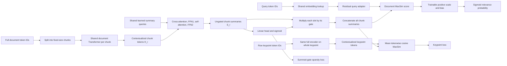

# Latent Bottleneck Compression: Theory and Implementation

The revised design represents each fixed-size document chunk with a bounded
set of learned vectors. A short query is encoded separately, and relevance is
computed by matching each query vector to its best summary vector across the
document's chunks. The main idea is to retain fine-grained matching while
limiting the vector budget per chunk.

Part 1 specifies the revised theory: chunk-based compression, summary blocks
with cross-attention and self-attention, and four losses: soft-target binary
cross-entropy, token-weighted coverage, keypoint matching, and gate sparsity.
Part 2 describes the corresponding Python implementation, its data formats,
and the training and inference APIs. Architectural motivations are
distinguished from properties that the losses actually enforce. The repository
does not include measured ranking or edge-latency results.

- [Part 1: Theory](#part-1-theory)
- [Part 2: Implementation](#part-2-implementation)

## Part 1: Theory

### 1.1 The problem: preserve evidence within a fixed vector budget per chunk

A reranker assigns a relevance score to a query and each candidate document.
Sorting these scores produces the final candidate ordering. The challenge is
to represent enough evidence to distinguish similar documents without running
an expensive joint query-document model for every candidate.

Three representation choices explain the motivation:

| Approach | Representation and interaction | Main tradeoff |
|---|---|---|
| Cross-encoder | Process the query and document together, allowing their tokens to interact throughout the model. | Rich interactions require a new joint forward pass for each pair. |
| Single-vector encoder | Encode a query and a document into one vector each. | Cheap comparison, but many facts must fit into one document vector. |
| Token-level late interaction | Encode independently, retain a document vector for each token, then match query vectors to document vectors. | Fine-grained matching, but storage and scoring grow with document length. |

This project takes the third approach and changes its document representation.
An arbitrary-length document is first split into fixed-size token chunks,
for example 1,024 tokens per chunk. The same compressor maps each chunk to a
fixed number of summary vectors, called **bottleneck slots**. Each slot can
gather information from anywhere within its chunk. Compression is performed
independently for every chunk; the vector budget is fixed per chunk rather
than for the entire document.

For example, consider a document that says:

> The Aurora instrument launched in 2019. Its successor, Borealis, launched
> three years later and uses a 14 nm sensor.

A direct query might ask for Borealis's sensor process. An indirect query might
ask which instrument followed Aurora and when it launched. Useful compression
must support the relationship across sentences while preserving the specific
values `2019`, `three years`, and `14 nm` when this evidence falls within the
same chunk. Chunk boundaries limit contextual reasoning: tokens in different
chunks do not attend to one another during encoding. Training only on a few
generated questions could overlook a value that no question happens to mention.

The model therefore combines relevance supervision, token coverage,
document-level keypoint matching, and a sparsity penalty on the gates.
Keypoints identify the main facts that the summaries should retain. This is
lossy representation learning: it does not reconstruct document text,
quantize model weights, or produce a textual summary.

### 1.2 Notation and the complete model

| Symbol | Meaning | Revised design / example |
|---|---|---|
| $Q$ | Query text | — |
| $D$ | Full document text | Arbitrary token length $N_D$ |
| $C$ | Fixed chunk size in student-tokenizer tokens | 1,024 |
| $J_D$ | Number of nonempty chunks in $D$ | $\lceil N_D/C\rceil$ |
| $C_r$ | Chunk $r$ of document $D$ | $1\leq r\leq J_D$ |
| $\ell_r$ | Number of real tokens in chunk $r$ | $1\leq\ell_r\leq C$ |
| $L_Q$ | Fixed number of query slots | 32 |
| $d$ | Vector width | 1024 |
| $M$ | Number of bottleneck slots per chunk | 32 |
| $L$ | Number of summary refinement blocks | Configurable |
| $H_r$ | Contextualized tokens of chunk $r$ | $\ell_r\times d$ before padding |
| $S_r=Z_r^{(L)}$ | Chunk summaries before gating | $M\times d$ |
| $\pi_r$ | Continuous gate values for chunk $r$ | $M$ |
| $B_r$ | Chunk bottleneck after multiplicative gating | $M\times d$ |
| $S_D$ | Concatenated chunk summaries before gating | $(J_DM)\times d$ |
| $\pi_D$ | Concatenated chunk gate values | $J_DM$ |
| $B_D$ | Gated document summaries | $\operatorname{diag}(\pi_D)S_D\in\mathbb R^{(J_DM)\times d}$ |
| $f$ | Keypoint text on a training row associated with document $D$ | Existing JSON `keypoint` field |
| $L_f$ | Number of real tokens in $f$ | Full keypoint length |
| $U_f$ | Contextualized keypoint token vectors | $L_f\times d$, shared full encoder |
| $\mathcal F_B$ | Distinct document/keypoint pairs in a batch | $P=\lvert\mathcal F_B\rvert$ |
| $Q_{\mathrm{latent}}$ | Encoded query vectors | $L_Q\times d$ |
| $S_\theta(Q,D)$ | Raw student MaxSim relevance score | One unbounded scalar |
| $a,b$ | Globally shared trainable score scale and bias | $a>0$, $b\in\mathbb R$ |
| $z_\theta(Q,D)$ | Student relevance logit | $aS_\theta(Q,D)+b$ |
| $p_\theta(Q,D)$ | Student relevance probability | $\sigma(z_\theta(Q,D))$ |
| $p_T(Q,D)$ | Frozen discriminative teacher target | A yes/no probability |

The relevance model has separate query and document paths, with an additional
keypoint branch during training:



The document representation is **query independent**. A particular query does
not influence which vectors the compressor produces. All chunks share the
compressor parameters, allowing their representations to be computed offline.
A document with $J_D$ chunks has $J_DM$ vectors before any external pruning;
only the per-chunk count is fixed.

### 1.3 Query encoding: a shallow residual adapter

The query path reuses the document backbone's input embedding table, but does
not run the query through the full document Transformer. It first truncates or
pads the query to $L_Q=32$ token IDs:

$$
X_Q = \operatorname{Embedding}
\left(\operatorname{PadWithMask}(Q,L_Q)\right).
$$

A small, bidirectional Transformer encoder $F_Q$ refines these embeddings:

$$
Q_{\mathrm{latent}}
= \operatorname{LayerNorm}\left(X_Q + F_Q(X_Q)\right).
$$

The residual path supplies the original embedding directly to the final
normalization. Its purpose is to make lexical information accessible while
learning a representation that matches the compressed document space. It is
an architectural bias toward preserving lexical signal, not a mathematical
guarantee of exact token matching: the embeddings, adapter, and normalization
are all trainable.

The implementation uses two Transformer encoder layers, eight attention heads,
and feed-forward width $4d$. Two details affect the theory of this query path:

- **Mask padding participates in computation.** The existing special token
  `<|vision_pad|>` fills unused query slots. These slots are passed through
  self-attention and included in the final MaxSim sum. They are not ignored
  padding; they can learn additional query-dependent matching behavior.
- **The adapter adds no positional encoding.** It receives embedding vectors
  without position embeddings or rotary position information. Its
  self-attention is permutation equivariant, and the final sum over query
  slots makes the score insensitive to permutations of the same query token
  IDs. It can model token co-occurrence, but has no explicit representation of
  query word order. The full document backbone still has its own positional
  machinery.

### 1.4 Chunk-based document compression

#### Stage A: split the document and contextualize each chunk

Tokenize the full document once with the student tokenizer, obtaining
$t_1,\ldots,t_{N_D}$. For a nonempty document, split the sequence into
consecutive, nonoverlapping chunks:

$$
C_r = [t_{(r-1)C+1},\ldots,t_{\min(rC,N_D)}],
\qquad r=1,\ldots,J_D.
$$

Every full chunk has exactly $C=1024$ tokens in this example. Right-pad the
last chunk to $C$ when needed and retain a validity mask. Padding is excluded
from document attention keys and the coverage loss. No document tokens are
discarded merely because the document is longer than one chunk.

The shared document backbone independently produces contextualized vectors
for each chunk:

$$
H_r = E_D(C_r) = [h_{r,1},\ldots,h_{r,\ell_r}].
$$

The student backbone is `Qwen/Qwen3-Embedding-0.6B`, with bidirectional
attention within each chunk and fully trainable weights. Each real token can incorporate
evidence before and after its position within that chunk. The chunk encoder
has no access to tokens in another chunk, so it does not provide contextual
reasoning across chunk boundaries.

#### Stage B: extract and refine a fixed set of summary vectors

The compressor owns a learned matrix of initial summary queries:

$$
Z^{(0)} = [s_1,\ldots,s_M] \in \mathbb R^{M\times d},
\qquad Z_r^{(0)}=Z^{(0)}.
$$

These are model parameters shared across all chunks and documents. They are
not text tokens and do not occupy positions in a chunk's input. Each chunk
starts from the same learned matrix, then refines it using that chunk's $H_r$.

For a single cross-attention head, the core operation is:

$$
\operatorname{Attention}(Q_s,K_r,V_r)
= \operatorname{softmax}
\left(\frac{Q_s K_r^\top}{\sqrt{d_h}} + A_r\right)V_r,
$$

where $Q_s$ comes from the summary vectors, $K_r$ and $V_r$ come from the
contextualized chunk, $d_h$ is the head width, and $A_r$ excludes padded
chunk keys. Multiple heads provide separate learned projections of the
same inputs.

Each refinement block has four pre-normalized residual sublayers, in this
order, for $\ell=0,\ldots,L-1$:

$$
\begin{aligned}
R_r^{(\ell)} &= Z_r^{(\ell)} + \operatorname{CrossAttn}
   (\operatorname{LN}(Z_r^{(\ell)}),\operatorname{LN}(H_r),
    \operatorname{LN}(H_r)),\\
U_r^{(\ell)} &= R_r^{(\ell)}
   + \operatorname{FFN}_1(\operatorname{LN}(R_r^{(\ell)})),\\
V_r^{(\ell)} &= U_r^{(\ell)}
   + \operatorname{SelfAttn}(\operatorname{LN}(U_r^{(\ell)})),\\
Z_r^{(\ell+1)} &= V_r^{(\ell)}
   + \operatorname{FFN}_2(\operatorname{LN}(V_r^{(\ell)})).
\end{aligned}
$$

Here $\operatorname{SelfAttn}(X)$ uses $X$ as queries, keys, and values, so
the $M$ summary slots communicate with one another within a chunk.
Cross-attention reads chunk evidence; summary self-attention lets the
extracted summaries exchange information before the next block. Each
sublayer has its own learned normalization parameters, with the key/value
normalization shared within a cross-attention sublayer.
$\operatorname{FFN}_1$ and $\operatorname{FFN}_2$ are separate networks,
each `Linear(d, 4d) → GELU → Linear(4d, d)`.

After $L$ blocks, the chunk summary matrix is:

$$
S_r = Z_r^{(L)} \in \mathbb R^{M\times d}.
$$

This is the reference architecture's final summary matrix $S=Z^{(L)}$,
written $S_r$ for chunk $r$. The scalar relevance score remains
$S_\theta(Q,D)$. The reference's $K$ slots and width $D$ correspond to
$M$ and $d$ here. Every slot can attend across its chunk, but slots in
different chunks never interact inside the compressor. A slot need not
correspond to a fixed span or a single word. Distinct facts per slot and
specialization remain learned behavior rather than guaranteed properties.

#### Stage C: predict continuous retention gates

A shared linear head predicts one scalar per slot:

$$
\pi_{r,k} = \sigma(w_g^\top s_{r,k}+c_g),
\qquad
b_{r,k} = \pi_{r,k} s_{r,k}.
$$

The sigmoid makes the operation differentiable. The same slot can receive a
different gate for each chunk because its vector $s_{r,k}$ already depends
on that chunk.

The gates learn through relevance supervision and the restored sparsity
penalty, which discourages total gate mass. Coverage uses ungated summaries.
The keypoint score below uses gated summaries inside cosine similarity;
positive gate scaling cancels in that cosine, so it does not directly
encourage gates to stay open. There is no explicit entropy calculation.

Soft gating does not change the tensor shape. The compressor returns $M$
vectors per chunk, and the scorer evaluates all $J_DM$ document vectors.
Counts such as “number of slots with $\pi>0.5$” are diagnostics. Turning them
into a smaller stored representation requires a separate hard-pruning policy.

### 1.5 Late interaction and the student relevance probability

Concatenate chunk summaries along the vector/sequence dimension, preserving
the embedding width $d$:

$$
S_D=\operatorname{Concat}(S_1,\ldots,S_{J_D}),
\qquad
\pi_D=\operatorname{Concat}(\pi_1,\ldots,\pi_{J_D}).
$$

Apply the corresponding scalar gate to every summary row:

$$
B_D
=\operatorname{diag}(\pi_D)S_D
=\operatorname{Concat}(B_1,\ldots,B_{J_D})
\in\mathbb R^{(J_DM)\times d}.
$$

This is the weighted representation $B_D=\pi_D\odot S_D$, where the
elementwise product broadcasts each gate across its summary vector's
$d$ features. It is used for both relevance scoring and keypoint matching.

Keep the MaxSim calculation, with its maximum taken over all document
summary vectors:

$$
S_\theta(Q,D)
= \sum_{i=1}^{L_Q}
  \max_{\substack{1\leq r\leq J_D\\1\leq k\leq M}}
  \frac{q_i^\top b_{r,k}}{\sqrt d}.
$$

For a single chunk, this is the original maximum over its $M$ slots.
For multiple chunks, each query slot selects its best match anywhere in the
document, and those best similarities are summed. Different query slots can
match different chunks or the same summary slot; matching is not one-to-one.
The maximum is taken across chunks **before** summing query-slot scores.
This is not a sum or maximum of independently summed chunk scores.

For a simplified two-query-slot, three-summary-slot similarity matrix after
scaling and gating:

| Query slot | Summary slot 1 | Summary slot 2 | Summary slot 3 | Selected value |
|---|---:|---:|---:|---:|
| $q_1$ | 0.8 | 0.1 | 0.3 | 0.8 |
| $q_2$ | 0.2 | 0.9 | 0.4 | 0.9 |

The raw score is $0.8+0.9=1.7$. MaxSim uses raw dot products, so vector
norms and gate magnitudes matter. The factor $1/\sqrt d$ controls scale,
but the score remains unbounded.

Introduce two globally shared trainable scalar parameters, a positive scale
$a$ and a bias $b$, after computing the document score:

$$
z_\theta(Q,D)=aS_\theta(Q,D)+b,
\qquad a>0,\quad b\in\mathbb R.
$$

Enforce positivity by learning an unconstrained scalar $\alpha$ and setting
$a=\operatorname{softplus}(\alpha)=\log(1+e^\alpha)>0$. Thus $\alpha$ and
$b$ are the two additional trainable parameters, with $a$ the effective scale.

Apply sigmoid to obtain the student relevance probability:

$$
p_\theta(Q,D)
=\sigma(z_\theta(Q,D))
=\frac{1}{1+\exp[-z_\theta(Q,D)]}.
$$

For finite logits, sigmoid maps to $(0,1)$. This gives a valid predicted
probability; statistical calibration must still be evaluated. Because $a$
is positive and sigmoid is strictly increasing, this transformation preserves
the ordering of raw MaxSim scores. Neither $a$ nor $b$ is document-specific.

Gating happens before the maximum. Multiplying by a small gate reduces a
positive similarity but moves a negative similarity toward zero. A nearly
closed slot can therefore still win if other similarities are negative.
Deleting such a slot can change the score, so hard pruning needs validation.

The model produces one prediction per query-document pair. These predictions
can order a candidate list, while the training objective below supervises
individual pairs rather than a listwise softmax or a ranking metric directly.

### 1.6 Two teachers provide different kinds of supervision

The design separates generating useful questions from judging relevance.

**The generative teacher supplies training examples.** Upstream generation
produces keypoints, direct queries, indirect queries, negative queries, and
hard negative queries. A keypoint is a factual anchor that associates the
queries with document content. The repository consumes these JSONL files;
it does not contain the generative teacher or its generation loop. The
70B-class generative model mentioned in the proposal is a design choice,
not a model instantiated here.

**The discriminative teacher supplies soft probability targets.** The teacher
is `Qwen/Qwen3-Reranker-8B`. Its wrapper puts the instruction, query,
and document into a single prompt, runs one causal-LM forward pass, and reads
the final-position logits for `yes` and `no`:

$$
p_T(Q,D)
= \frac{\exp(z_{yes})}{\exp(z_{no})+\exp(z_{yes})}
= \sigma(z_{yes}-z_{no}).
$$

This is a two-token relevance probability, used directly as the soft target.
It is not thresholded into a hard positive or negative label. Calling it a
probability describes the calculation; the repository does not establish its
statistical calibration.

Teacher targets must describe the same scoring unit as the student
prediction. For the document score above, obtain one target for $(Q,D)$ and
apply it after combining the document's chunk summaries. Do not assign that
document target independently to every chunk: a relevant document can contain
chunks with no relevant evidence. If a chunk is used as a standalone training
item, the teacher must judge that same chunk. Obtaining targets for documents
beyond the teacher's context budget requires a defined long-document teacher
policy. The implemented teacher rejects inputs beyond its configured context
budget instead of silently truncating the document.

Teacher probabilities are precomputed and saved. During student training,
the teacher is frozen, is not loaded into the student training loop, and
receives no gradients.

#### Row-level keypoint JSON supervision

Use the keypoint $f$ already present on each document-linked training row:

```json
{
  "doc_id": "doc-001",
  "keypoint": "Borealis uses a 14 nm sensor."
}
```

The body for the same `doc_id` supplies the full document $D$. A document
can have several rows with different keypoints. Each nonempty `keypoint`
is used directly by the keypoint loss, in addition to organizing its row's
query supervision. No additional keypoint field or separate file is needed.

Within a batch, document encoding is shared by all rows with the same
`doc_id`. Let $\mathcal F_B$ contain each distinct $(D,f)$ pair once;
repeated rows for the same pair do not multiply its keypoint penalty.
Different keypoints of the same document remain separate training targets.

### 1.7 The four training losses

The revised objective combines soft-target binary cross-entropy for relevance,
coverage within each chunk, matching each row's associated keypoint, and
sparsity over all of a document's gates.

#### A. Soft-target binary cross-entropy: match teacher probabilities

Let $n$ index the $N$ valid query-document training pairs, with
$p_{T,n}=p_T(Q_n,D_n)$ and
$p_{\theta,n}=\sigma(aS_\theta(Q_n,D_n)+b)$. The relevance loss is:

$$
\mathcal L_{\mathrm{BCE}}
= -\frac{1}{N}\sum_{n=1}^{N}
  \left[
  p_{T,n}\log p_{\theta,n}
  +(1-p_{T,n})\log(1-p_{\theta,n})
  \right].
$$

Direct, indirect, ordinary negative, and hard negative queries each contribute
their own pair loss against the corresponding document and teacher target.
For example, a row with two positive queries, two negatives, and two hard
negatives contributes six valid BCE terms. A teacher target of $0.9$ asks
the student to predict $0.9$, while a target of $0.2$ asks it to predict
$0.2$. Direct and indirect predictions can differ when their teacher targets
differ.

For numerical stability, evaluate BCE directly from the logits, using
$-\left[p_T\log\sigma(z)+(1-p_T)\log(1-\sigma(z))\right]
=\operatorname{softplus}(z)-p_Tz$. With a validity mask $m_n$ for padded
query entries, the batched form is:

$$
\mathcal L_{\mathrm{BCE}}
= \frac{\sum_n m_n
  \left[\operatorname{softplus}(z_{\theta,n})-p_{T,n}z_{\theta,n}\right]}
  {\max(1,\sum_n m_n)}.
$$

Use a numerically stable BCE-with-logits operation on $z_{\theta,n}$, with
the teacher probability as its target. Sigmoid defines the predicted
probability; do not apply it again before a BCE-with-logits operation.
Missing query entries contribute neither loss nor count.

#### B. Coverage loss: preserve weighted token coverage within each chunk

Relevance supervision observes only the questions present in the training
data. Coverage compares a chunk's contextualized tokens $H_r$ with **that
same chunk's** ungated summaries $S_r$. Coverage remains local to each
chunk. The keypoint loss below instead matches against summaries from all
chunks of the associated document.

Define cosine distance for real token positions $j=1,\ldots,\ell_r$ and
summary slots $k=1,\ldots,M$:

$$
c_{r,jk}
=1-\frac{h_{r,j}^\top s_{r,k}}
        {\lVert h_{r,j}\rVert\lVert s_{r,k}\rVert}.
$$

Normalize vectors in float32 with a small norm epsilon for numerical
stability. Exclude padded token positions from coverage.

Use the revised nonnegative IDF weight for each real token:

$$
w_{r,j}
= \log\frac{N_{\mathrm{corpus}}+1}
              {\operatorname{df}(t_{r,j})+1}
\geq 0.
$$

Here $N_{\mathrm{corpus}}$ is the number of original corpus documents, and
$\operatorname{df}(t)$ counts documents containing token $t$ at least once.
Splitting documents into chunks does not change the unit of document
frequency. For $0\leq\operatorname{df}(t)\leq N_{\mathrm{corpus}}$, these
weights are nonnegative. A token present in every document receives zero
weight; an unseen token receives $\log(N_{\mathrm{corpus}}+1)$.

Let $W_r=\sum_{j=1}^{\ell_r}w_{r,j}$. For a chunk with $W_r>0$, define:

$$
\mathcal L_{\mathrm{coverage}}(C_r)
= \frac{\sum_{j=1}^{\ell_r}
          w_{r,j}\min_{1\leq k\leq M}c_{r,jk}}
        {\sum_{j=1}^{\ell_r}w_{r,j}}.
$$

This is a weighted average of nearest-summary cosine distances, normalized
by total token weight rather than token count. Rare tokens receive greater
relative importance. Repeated token positions contribute separately,
including their weights in the denominator. Padding contributes neither
distance nor weight.

If $W_r=0$, define $\mathcal L_{\mathrm{coverage}}(C_r)=0$ and use a safe
denominator when evaluating the formula so no division by zero occurs.
Such a chunk contributes no coverage gradient; keypoint matching, relevance,
and sparsity still apply. For positive $W_r$, use the exact total weight as
the denominator.

Let $\mathcal U$ be the set of unique chunks belonging to documents in the
batch. The standalone batch coverage loss is:

$$
\mathcal L_{\mathrm{coverage}}
= \frac{1}{|\mathcal U|}
  \sum_{C_r\in\mathcal U}\mathcal L_{\mathrm{coverage}}(C_r).
$$

Chunks with zero total token weight contribute zero to this average and
remain included in its chunk count.

#### C. Keypoint loss: preserve each row's factual content

Tokenize the whole row keypoint $f$ and pass all of its real tokens
through the same full encoder used to contextualize document chunks:

$$
U_f=E_D(f)=[u_1,\ldots,u_{L_f}]
\in\mathbb R^{L_f\times d}.
$$

This shares the backbone and input embedding table with the document path.
It produces one contextualized vector per keypoint token, without pooling,
summary compression, or the query adapter's fixed 32-slot truncation. The
keypoint encoder is trainable and shares parameters with the document
encoder; its outputs are not detached targets or a separate frozen teacher.
Since both sides have width $d$, the reference projection $P_\phi$ is the
identity.

Match each real keypoint token against the **gated** document summary set
$B_D=\operatorname{diag}(\pi_D)S_D$:

$$
g(S_D,f)
=\frac{1}{L_f}\sum_{i=1}^{L_f}
  \max_{\substack{1\leq r\leq J_D\\1\leq k\leq M}}
  \cos(u_i,b_{r,k}),
\qquad b_{r,k}=\pi_{r,k}s_{r,k}.
$$

The notation $g(S_D,f)$ includes the gates through $B_D$. This is the
mean of each keypoint token's best cosine match across all real document
chunks. The keypoint tokens have equal weight; the coverage IDF weights
are not applied here. Multiple tokens may select the same summary slot,
and different tokens may match different chunks.

Define the loss for that keypoint as requested:

$$
\mathcal L_{\mathrm{keypoint}}(D,f)=1-g(S_D,f).
$$

For exact cosine similarity on nonzero vectors, $g\in[-1,1]$ and this loss
lies in $[0,2]$. It is a matching objective, not a relevance probability.

Exclude keypoint padding from encoder attention and the token average.
Exclude padded or nonexistent document chunks from the maximum; zero-filled
batch padding must not act as candidate summaries. Require a nonempty row
keypoint, so $L_f>0$. For numerical stability, implement cosine in float32
with epsilon-safe normalization:

$$
\cos_\epsilon(x,y)
=\left(\frac{x}{\max(\lVert x\rVert,\epsilon)}\right)^\top
 \left(\frac{y}{\max(\lVert y\rVert,\epsilon)}\right).
$$

This gives zero similarity for an exactly zero vector. It is a numerical
safeguard; padded candidates are still explicitly excluded.

Average the keypoint loss over the $P=|\mathcal F_B|$ distinct
document/keypoint pairs in the batch:

$$
\mathcal L_{\mathrm{keypoint}}
=\frac{1}{|\mathcal F_B|}
  \sum_{(D,f)\in\mathcal F_B}
  \mathcal L_{\mathrm{keypoint}}(D,f).
$$

Rows sharing the same document and keypoint do not repeat that pair's loss.
Different keypoints for one document each contribute a term while reusing
the same document summaries.

**Positive gate scaling cancels inside cosine.** For nonzero keypoint and
summary vectors and $\pi_{r,k}>0$:

$$
\cos(u_i,\pi_{r,k}s_{r,k})=\cos(u_i,s_{r,k}).
$$

Consequently, the requested keypoint loss aligns summary directions but has
no direct gradient on the gate scalar in this regime. Epsilon normalization
can break the cancellation when gated norms approach the epsilon floor;
that numerical effect is not reliable supervision for retention. The loss
does not ensure that keypoint-matching slots survive sparsity or hard pruning.

#### D. Sparsity loss: penalize total document gate mass

Let $\mathcal D_B$ be the set of unique documents in the batch. Restore
the sum-of-gates penalty, averaged over these documents:

$$
\mathcal L_{\mathrm{sparsity}}
=\frac{1}{|\mathcal D_B|}
  \sum_{D\in\mathcal D_B}
  \sum_{r=1}^{J_D}\sum_{k=1}^{M}\pi_{D,r,k}.
$$

The additional $D$ index makes the document association explicit. Every real
chunk and summary slot contributes; batching padding does not. This is an
$L_1$ penalty on nonnegative gate values, rather than binary entropy. Longer
documents contribute more terms because they have more chunks; the penalty
is a document-level sum, not a per-slot mean.

Sparsity encourages smaller total gate mass, while relevance supervision
can favor retaining useful weighted summaries. The coverage loss and, away
from the numerical epsilon floor, the cosine keypoint loss do not directly
oppose shrinking gates. Raw dot-product relevance also depends on summary
norms, so changing vector norms can partly compensate for gate scaling.
Lower gate mass is therefore neither a guarantee of a particular active
slot count nor a physical reduction in stored vectors. That reduction still
requires a separate pruning policy.

Coverage and keypoint matching both use cosine directions, which do not
enforce the vector magnitudes used by relevance MaxSim. The document and
keypoint encoder share trainable parameters, so their representations can
move together. Low alignment losses alone do not establish exact fact
preservation.

### 1.8 Joint optimization

The complete revised objective has four components:

$$
\boxed{
\mathcal L_{\mathrm{total}}
= \mathcal L_{\mathrm{BCE}}
 +\lambda_{\mathrm{coverage}}\mathcal L_{\mathrm{coverage}}
 +\lambda_{\mathrm{keypoint}}\mathcal L_{\mathrm{keypoint}}
 +\lambda_{\mathrm{sparsity}}\mathcal L_{\mathrm{sparsity}}.
}
$$

Precision is replaced by keypoint matching. Sparsity is restored.
Margin-MSE and consistency loss remain excluded. Each auxiliary loss has
its own nonnegative coefficient.

Example starting weights for the revised theory are:

| Parameter | Value | Effect |
|---|---:|---|
| $\lambda_{\mathrm{coverage}}$ | 1.0 | Strength of token coverage within each chunk |
| $\lambda_{\mathrm{keypoint}}$ | 1.0 | Strength of matching each document/keypoint pair |
| $\lambda_{\mathrm{sparsity}}$ | 0.01 | Cost of summed gate mass across a document's chunks |

The shared embedding table and document/keypoint backbone, query adapter,
initial summary queries, cross-attention and self-attention layers, both
FFNs per summary block, normalization layers, gating head, and score
parameters $\alpha,b$ are optimized jointly. The keypoint branch introduces
no independent encoder parameters. Teacher probabilities, keypoint text, and
corpus-derived token weights remain fixed; keypoint token vectors are
recomputed through the shared trainable encoder.

BCE averages over valid query-document examples. Coverage averages over
unique chunks, keypoint loss over unique document/keypoint pairs, and
sparsity over unique documents. Repeated query rows add relevance
supervision without repeating the same pair's keypoint penalty or the
document's coverage and sparsity penalties. The four losses can have
different scales; interpret their coefficients alongside separately logged
component values.

### 1.9 What compression saves, and what remains expensive

A conventional token-level representation stores $N_Dd$ vector elements for
a document. Chunk compression stores $J_DMd$ elements. Its vector-count
reduction factor is:

$$
\frac{N_D}{J_DM}.
$$

A full 1,024-token chunk compressed to $M=32$ slots has a $32\times$
vector-count reduction. For a 2,500-token document, the chunks contain
1,024, 1,024, and 452 real tokens, producing $3\times32=96$ summary
vectors, for a reduction of $2500/96\approx26.04\times$.
The short final chunk still receives $M$ slots. A document shorter than
$M$ tokens can therefore have more summary vectors than token vectors.
The design fixes capacity per chunk rather than guaranteeing a reduction
for every input.

At $M=32$ and $d=1024$, the dense vector payload per chunk occupies:

- 65,536 bytes, or 64 KiB, with two-byte elements;
- 131,072 bytes, or 128 KiB, with four-byte elements.

Multiply by $J_D$ for the whole document. These figures exclude model
weights, IDs, gate metadata, indexing overhead, and temporary tensors.
Training in bf16 does not automatically define an inference storage dtype.

MaxSim evaluates $L_QJ_DM$ vector dot products per document, each of width
$d$, giving arithmetic cost $O(L_QJ_DMd)$. With $L_Q=32$ and $M=32$,
that is 1,024 dot products per chunk, or approximately 1.05 million scalar
multiply-accumulates at width 1024. The whole-document cost grows with its
chunk count.

Document encoding remains the expensive part: the full backbone runs
independently on every chunk before compression. Each summary block adds
cross-attention interactions costing $O(MCd)$ and summary self-attention
interactions costing $O(M^2d)$ per chunk, in addition to projections and
FFNs. Across $L$ blocks and $J_D$ chunks, those interaction costs are
$O(LJ_D(MC+M^2)d)$. Training also retains uncompressed chunk states and
computes an $\ell_r\times M$ cosine-distance matrix per chunk for coverage.
Keypoint supervision adds a full encoder pass for each distinct $(D,f)$
pair and an $L_f\times(J_DM)$ cosine-similarity matrix for its document.
These keypoint computations are needed during training; serving query-document
scores does not require the keypoint branch.

The intended serving advantage comes from compressing chunks in advance
and encoding a query once for many candidate documents. Chunking bounds
each compression input, while total storage and scoring still grow with
document length. Neither the fixed per-chunk budget nor these operation
counts establish a deployment latency.

## Part 2: Implementation

The code implements the four-loss objective in Part 1. Configuration and
saved data from the earlier margin/Chamfer model need migration before a
new training run.

### 2.1 Repository structure and responsibilities

| Component | Implementation |
|---|---|
| Model, data, loss, teacher, and training configuration | [src/config.py](../src/config.py), [configs/default.yaml](../configs/default.yaml) |
| Join upstream document, query, and negative-query files | [src/data/build_index.py](../src/data/build_index.py) |
| Full-document corpus frequencies and coverage weights | [src/data/idf.py](../src/data/idf.py) |
| Lazy scored rows, keypoint-pair deduplication, and chunk batching | [src/data/dataset.py](../src/data/dataset.py) |
| Full-document teacher targets and resumable precomputation | [teacher wrapper](../src/distill/teacher_qwen_reranker.py), [precomputation](../src/distill/precompute_teacher_scores.py) |
| Padding-only backbone attention | [src/model/bidirectional.py](../src/model/bidirectional.py) |
| Shallow query encoder | [src/model/query_adapter.py](../src/model/query_adapter.py) |
| Cross-attention, FFN1, self-attention, FFN2, and gating | [src/model/document_compressor.py](../src/model/document_compressor.py) |
| Chunk aggregation, shared keypoint encoder, MaxSim, and probability | [src/model/reranker.py](../src/model/reranker.py) |
| BCE, coverage, keypoint matching, and sparsity | [src/losses.py](../src/losses.py) |
| Batch forward, optimization, metrics, and checkpoints | [src/train.py](../src/train.py) |
| Gate and representation inspection | [inspect_bottleneck.py](../src/eval/inspect_bottleneck.py), [sample_beir_compress.py](../src/eval/sample_beir_compress.py) |

### 2.2 Configuration

The checked-in YAML uses the following settings:

| Setting | Value or behavior |
|---|---|
| Backbone and width | `Qwen/Qwen3-Embedding-0.6B`, 1024 dimensions |
| Chunk size | `model.doc_chunk_size: 1024`; no whole-document prefix limit |
| Summary capacity | 32 slots per chunk; one refinement block; eight attention heads |
| Query adapter | 32 slots, two layers, eight heads, fill token `<\|vision_pad\|>` |
| Teacher budget | 32,768 tokens for the entire formatted input, including query and prompt |
| Keypoint source | Existing `keypoint` field on each scored row |
| Loss weights | Coverage 1.0, keypoint 1.0, sparsity 0.01; BCE coefficient 1 |
| Optimizer | AdamW, learning rate `2e-5`, weight decay 0.01 |
| Training | Batch size 8 query rows, four accumulation steps, five epochs, bf16 |

`Config.from_yaml` starts with dataclass defaults and replaces specified
fields. The Python epoch default is three; the YAML overrides it to five.
The former `doc_max_len`, `lambda_chamfer`, `lambda_consistency`,
and `chamfer_beta` fields are removed. Update old YAML files.

The data-building, IDF, and teacher-precomputation CLIs use their own
arguments. Use teacher precomputation's `--max-length` to change its budget;
editing a training YAML does not configure that separate CLI.

### 2.3 Training rows and keypoints

Training consumes teacher-scored JSONL. A minimal row has the following
shape; values are illustrative:

```json
{
  "doc_id": "doc-001",
  "body": "Borealis uses a 14 nm sensor.",
  "keypoint": "Borealis uses a 14 nm sensor.",
  "direct_query": "What sensor process does Borealis use?",
  "indirect_query": "What sensor process does Aurora's successor use?",
  "negative_queries": ["What material is Borealis's housing made from?"],
  "hard_negative_queries": ["Does Borealis use a 7 nm sensor?"],
  "teacher_scores": {
    "direct": 0.94,
    "indirect": 0.89,
    "negative_queries": [0.02],
    "hard_negative_queries": [0.18]
  },
  "teacher_metadata": {
    "teacher_name": "Qwen/Qwen3-Reranker-8B",
    "instruction": "Given a web search query, retrieve relevant passages that answer the query",
    "max_length": 32768,
    "document_scope": "full_document"
  }
}
```

Negative query lists may be empty. Their teacher arrays must match their
lengths and ordering. Every actual target must be a finite probability in
$[0,1]$. Queries, document bodies, and each row's `keypoint` must be nonempty.
Several rows may share a `doc_id` while supplying different keypoints.

`ScoredExamplesDataset` scans rows and indexes byte offsets. It validates
that repeated document IDs have the same body. Bodies are loaded on demand
rather than all kept in memory. The collator encodes each distinct document
once and each distinct `(doc_id, keypoint)` pair once in a batch. Every
query row retains its own relevance supervision.

Training enables `require_full_document_teacher=True`. Every row must
declare `teacher_metadata.document_scope: "full_document"`, with consistent
teacher settings or external policy/source metadata. Old prefix-scored
examples without this provenance are rejected. External targets must
describe the full-document policy actually used to obtain them.

The existing `build_index` joins the three upstream document/keypoint,
positive-query, and negative-query sources by `doc_id` and exact keypoint
string. Its existing `keypoint` field is used directly for keypoint matching.

### 2.4 Build full-document coverage weights

`build_idf_table` reads nonempty bodies from `keypoints_part*.jsonl` in
the corpus directory. It tokenizes every body without truncation, counts
each token ID once per original document, and deduplicates repeated
`doc_id` records. Conflicting bodies and an empty corpus are rejected.
Splitting documents for compression does not change the frequency unit.

The saved token weight is:

$$
w(t)=\log\frac{N_{\mathrm{corpus}}+1}{\operatorname{df}(t)+1}.
$$

A ubiquitous token receives zero; an unseen token receives
$\log(N_{\mathrm{corpus}}+1)$. The artifact includes compatibility metadata:

```python
{
    "idf": idf_tensor,
    "n_docs": n_docs,
    "tokenizer": tokenizer_name,
    "version": 2,
    "formula": "log((N+1)/(df+1))",
    "scope": "full_documents",
}
```

Training verifies the metadata, tokenizer identity, vocabulary size, and
finite nonnegative weights. Rebuild old signed-IDF or 4,096-token-prefix
artifacts with the new CLI. For a custom corpus, supply original-document
records containing `body` in files matching the corpus filename pattern.

### 2.5 Precompute full-document teacher probabilities

`QwenRerankerTeacher` formats the instruction, full query, and full document
inside its yes/no prompt. One causal-LM forward pass reads final-position
`yes` and `no` logits; their two-class softmax gives the target probability.
Scoring runs without gradients.

Neither text is truncated. If the complete formatted pair exceeds
`teacher.max_length` or the configured budget exceeds the model context,
the wrapper raises an error. The default total budget is 32,768 tokens.
Longer documents need externally computed targets from an explicit
long-document teacher policy.

`precompute_teacher_scores` selects the first configured number of negative
and hard-negative queries, flattens pairs, scores batches, and saves complete
rows with `teacher_scores` and `teacher_metadata`. It always scores the
full body, rather than a chunk or the student's shortened query.

Precomputation resumes by output line count and verifies the existing
teacher model, instruction, context budget, and document scope before
appending. Input order and negative limits must still match the original
run. Regenerate old truncated targets into a new file or use `--overwrite`;
they cannot be silently mixed into a full-document run.

### 2.6 Tensor batches and masks

Let $B$ be the query-row count, $U$ the unique-document count,
$P$ the distinct document/keypoint-pair count, $N_c=\sum_D J_D$ the real
chunk count, $C$ the chunk size, and $L_f^{\max}$ the longest keypoint.
`Collator` tokenizes each distinct body without truncation, splits it into
chunks, and right-pads partial final chunks. Keypoints retain every token
and are padded to the batch maximum.

| Batch field | Shape | Meaning |
|---|---|---|
| `doc_input_ids` | $(N_c,C)$ | All real document chunks |
| `doc_attention_mask` | $(N_c,C)$ | Real tokens versus final-chunk padding |
| `chunk_doc_index` | $(N_c,)$ | Unique-document owner per chunk |
| `doc_index` | $(B,)$ | Unique-document owner per query row |
| `keypoint_input_ids` | $(P,L_f^{\max})$ | Complete keypoint per distinct document/keypoint pair |
| `keypoint_attention_mask` | $(P,L_f^{\max})$ | Real keypoint tokens |
| `keypoint_doc_index` | $(P,)$ | Unique-document owner per keypoint pair |
| `direct_query_ids`, `indirect_query_ids` | $(B,L_Q)$ each | Fixed-slot positive queries |
| `neg_query_ids`, `hardneg_query_ids` | $(B,N,L_Q)$, $(B,N_h,L_Q)$ | Padded negative-query entries |
| `neg_query_mask`, `hardneg_query_mask` | $(B,N)$, $(B,N_h)$ | Real query entries |
| `teacher_direct`, `teacher_indirect` | $(B,)$ each | Positive teacher targets |
| `teacher_neg`, `teacher_hardneg` | $(B,N)$, $(B,N_h)$ | Negative teacher targets |

Query token fill slots participate in query encoding and MaxSim. Missing
negative-query **entries** are different: their masks exclude them from BCE.
Each negative tensor keeps at least one dummy entry for a uniform tensor
path, including when that negative type is absent.

### 2.7 Model interfaces and summary extraction

The backbone is shared by document chunks, keypoint encoding, and the query
embedding lookup. No frozen keypoint model is created. The loader uses SDPA,
padding-only bidirectional attention, and no cache. The patch depends on
the Qwen3 attention interface supported by the installed Transformers version.

Summary blocks implement CrossAttn → FFN1 → SelfAttn → FFN2, with pre-norm
and a residual add at each step. Chunks start from the same learned summary
queries. The following code names distinguish chunk tensors from complete
document tensors:

| Output key | Shape | Theory / use |
|---|---|---|
| `h_d` | $(N_c,C,d)$ | Contextualized chunk tokens for coverage |
| `doc_attention_mask` | $(N_c,C)$ | Real-token mask |
| `b_d` | $(N_c,M,d)$ | Ungated $S_r$, used by coverage |
| `pi` | $(N_c,M)$ | Continuous gates |
| `b_d_tilde` | $(N_c,M,d)$ | Gated $B_r$, before document packing |
| `chunk_input_ids` | $(N_c,C)$ | IDs for IDF lookup |
| `chunk_doc_index` | $(N_c,)$ | Chunk owners |
| `document_vectors` | $(U,\max_D J_DM,d)$ | Packed gated document summaries |
| `document_summary_mask` | $(U,\max_D J_DM)$ | Real summaries versus packing padding |

`encode_document(input_ids, attention_mask)` accepts complete document rows
and chunks them internally. Already chunked inputs can supply
`chunk_doc_index` and `num_documents` explicitly. `encode_keypoint` runs
the whole keypoint through the same backbone. `encode_query` uses the
shared embedding lookup and shallow adapter.

For whole-document `maxsim(q, b, summary_mask)`, use `document_vectors` and
its mask. The maximum spans every real chunk before summing query slots.
`scores_to_logits` applies $aS+b$, and `scores_to_probabilities` applies
sigmoid. The effective positive scale is `softplus(score_alpha)`,
initialized to 1; `score_bias` starts at 0. A tiny positive numerical floor
prevents scale underflow.

### 2.8 Training forward, losses, and saved artifacts

Each microbatch invokes `model(mode="training", batch=batch)` once. That
wrapped forward includes document compression, keypoint encoding, all query
encodings, document MaxSim, and the score scale/bias. Every trainable branch
therefore belongs to the distributed wrapper's forward graph.

Outputs include `doc_out`, `keypoint_vectors` with shape $(P,L_f^{\max},d)$,
and row-wise `scores`, `logits`, and `probabilities`. Query columns are ordered direct, indirect,
ordinary negatives, then hard negatives. `forward_batch_and_loss` computes:

1. Stable masked BCE-with-logits against teacher probabilities.
2. Coverage of real chunk tokens by ungated summaries.
3. Keypoint token matching against all gated summaries of the associated
   document, averaged over unique document/keypoint pairs.
4. Gate sums across chunks, averaged over unique documents.

Cosine matrices use float32 with autocast disabled and epsilon-safe norms.
Zero-total-weight chunks contribute zero coverage and remain in the chunk
average. `keypoint_doc_index` selects each keypoint's document summaries
and validity mask. Keypoint vectors retain gradients through the shared
encoder.
The requested keypoint score retains the positive-gate cancellation
described in Part 1.

Training uses Accelerate, AdamW, linear warmup/decay, gradient accumulation,
and gradient clipping. Incomplete batches are kept. The scheduler uses
`ceil(len(prepared_loader) / grad_accum_steps) * epochs` after distributed
loader preparation.

| Saved artifact | Contents |
|---|---|
| `config.yaml` | Effective configuration, including CLI overrides |
| Tokenizer files | Student tokenizer saved with `save_pretrained` |
| `metrics.csv` and TensorBoard | Total, BCE, coverage, keypoint, and sparsity |
| `checkpoint-<step>.pt` | Periodic model `state_dict` |
| `final_model.pt` | Final model `state_dict` |

Loss logs describe the current microbatch on the main process. Checkpoints
contain weights rather than optimizer, scheduler, RNG, or data-order state;
full training resume is not implemented.

### 2.9 Run training and score a complete document

With dependencies installed and input data available:

```bash
# When using the existing upstream sources, build joined query rows.
./scripts/run_build_index.sh

# Build version-2 nonnegative weights over full original documents.
./scripts/run_build_idf.sh

# Obtain full-document teacher probabilities and provenance.
./scripts/run_precompute_teacher.sh

# Train using the keypoint already present on each scored row.
./scripts/run_train.sh
```

Custom scored data and paths can be supplied directly:

```bash
accelerate launch -m src.train \
  --config configs/default.yaml \
  --scored-path data/unified_examples.scored.jsonl \
  --idf-path data/idf_table.pt \
  --output-dir runs/default
```

For inference, tokenize the full document without truncation and use its
packed summaries and validity mask:

```python
import torch
from transformers import AutoTokenizer

from src.config import Config
from src.data.dataset import pad_query_ids
from src.model.reranker import LatentBottleneckReranker

run_dir = "runs/default"
cfg = Config.from_yaml(f"{run_dir}/config.yaml")
tokenizer = AutoTokenizer.from_pretrained(run_dir)
model = LatentBottleneckReranker(cfg.model)
model.load_state_dict(
    torch.load(f"{run_dir}/final_model.pt", map_location="cpu", weights_only=True)
)
model.eval()

document = "Borealis uses a 14 nm sensor."
query = "What sensor process does Borealis use?"
inputs = tokenizer(
    document, add_special_tokens=False, truncation=False, return_tensors="pt"
)
mask_id = tokenizer.convert_tokens_to_ids(cfg.model.mask_token)
query_ids = torch.tensor([
    pad_query_ids(tokenizer, query, cfg.model.query_max_len, mask_id)
], dtype=torch.long)

with torch.no_grad():
    doc_out = model.encode_document(inputs["input_ids"], inputs["attention_mask"])
    q = model.encode_query(query_ids)
    score = model.maxsim(
        q, doc_out["document_vectors"], doc_out["document_summary_mask"]
    )
    probability = model.scores_to_probabilities(score)

print(probability.item())
```

Keypoints are only required for training. A serving application can cache
document summaries, encode each query once, and score cached representations.
A persistent index and candidate-management service are outside this code.

### 2.10 Compatibility, diagnostics, and validation scope

New self-attention, a second FFN per summary block, and scale/bias parameters
make earlier checkpoints architecture-incompatible. Train this model from
the pretrained backbone with normally initialized compressor layers.

Before migrating an earlier run:

- Replace old configuration fields with current chunk and loss settings.
- Rebuild IDF artifacts with version 2 and full-document scope.
- Regenerate prefix-based teacher targets with full-document provenance.

Inspection utilities encode the whole supplied document and flatten
summaries across all chunks. They report gates, nearest raw embedding
neighbors, cosine heatmaps, and vector norms. These are interpretability
heuristics rather than factual reconstruction or ranking evaluation.

Focused tests use tiny tokenizers/backbones and synthetic vectors to verify
chunk retention, masks, teacher probabilities, loss reductions, and gradients
without downloading pretrained weights. Full pretrained-model training,
ranking evaluation, persistent indexing, hard pruning, quantization, export,
and measured edge latency remain separate work.
